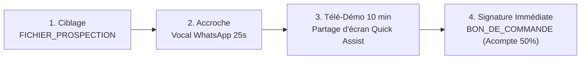

# 🎯 03 — VENTE, PROSPECTION ET NÉGOCIATION COMMERCIALE
## La Machine de Télé-Prospection & de Closing 100% à Distance

Ce dossier regroupe l'arsenal commercial complet pour prospecter, qualifier, convaincre et faire signer des artisans et entrepreneurs du BTP, **exclusivement à distance (zéro déplacement physique)** via WhatsApp, téléphone, visioconférence et bon de commande numérique.

---

### 🗂️ CATALOGUE DES 9 OUTILS COMMERCIAUX

```
03_Vente_et_Prospection_Terrain/
│
├── README.md                                      ← Ce guide d'orientation commerciale
├── MANUEL_PROSPECTION_VENTE_ET_TERRAIN.md        ← La bible commerciale (scripts vocaux WhatsApp, 7 objections, closing)
├── BATTLECARD_8SEC_VERTUOZA.md                   ← Fiche de contre-attaque en 8 secondes face aux logiciels ERP lourds
├── LANDING_ALTERNATIVE_VERTUOZA.html             ← Page web de conversion comparative responsive (HTML5 / Tailwind)
├── SLIDES_DEMO_CLIENT_10MIN.html                 ← Présentation interactive 5 slides pour télé-démo 10 min Quick Assist
├── BON_DE_COMMANDE_PROPOSITION_COMMERCIALE.md    ← Contrat de vente 1 page + 9 CGV de protection juridique
├── FICHIER_PROSPECTION_LIEGE_BTP.xlsx            ← Base de données prospects qualifiée (entreprises pilotes région liégeoise)
├── generate_prospection_sheet.py                 ← Générateur automatique de la base de prospection Excel
├── extract_belgian_btp_leads.py                  ← Extracteur & scanner de prospects BTP certifiés par NACE-BEL et commune
└── WIN_WIRE_EXEMPLE_LIEGE.md                     ← Annonce flash de victoire commerciale (Deal Herstal 1 800 €)
```

---

### 🚀 LE WORKFLOW DE VENTE EN 4 TEMPS (100% NUMÉRIQUE)



1. **Étape 1 — Sélection du prospect :**  
   Consultez [`FICHIER_PROSPECTION_LIEGE_BTP.xlsx`](./FICHIER_PROSPECTION_LIEGE_BTP.xlsx). Sélectionnez un artisan (chauffagiste, électricien, carreleur, maçon).  
   *Régénération du fichier :* `python 03_Vente_et_Prospection_Terrain/generate_prospection_sheet.py`

2. **Étape 2 — L'Accroche WhatsApp (Vocal de 25 secondes) :**  
   Utilisez le script du chapitre 1.2 de [`MANUEL_PROSPECTION_VENTE_ET_TERRAIN.md`](./MANUEL_PROSPECTION_VENTE_ET_TERRAIN.md) :  
   *« Bonjour Monsieur [Nom], Brandon à l'appareil... Une question rapide : combien de devis restent sans réponse chaque mois simplement parce que vous n'avez pas le temps de rappeler 10 jours après ? »*

3. **Étape 3 — Neutralisation des objections :**  
   - Si l'artisan mentionne un logiciel comme Vertuoza ou un devis lourd : dégainez la [`BATTLECARD_8SEC_VERTUOZA.md`](./BATTLECARD_8SEC_VERTUOZA.md) ou envoyez le lien de la page web [`LANDING_ALTERNATIVE_VERTUOZA.html`](./LANDING_ALTERNATIVE_VERTUOZA.html).
   - S'il dit que sa femme s'en occupe déjà : activez l'argument du Détecteur de Fuites de Marge et de l'Avenant Chantier WhatsApp.

4. **Étape 4 — Closing et émission du Bon de Commande :**  
   Faites signer numériquement le [`BON_DE_COMMANDE_PROPOSITION_COMMERCIALE.md`](./BON_DE_COMMANDE_PROPOSITION_COMMERCIALE.md). Encaissez l'acompte de 50 % avant toute télé-installation.


## 🛡️ Conformité RGPD de la prospection (obligatoire avant tout envoi)

- **Base légale** : intérêt légitime (Art. 6.1.f RGPD) — prospection B2B pour des services en lien avec la fonction du contact. À documenter dans un registre de traitement.
- **Obligations** : mention de l'identité de l'expéditeur dans chaque message, information sur le droit d'opposition, traitement de toute demande d'opt-out sous 24 h (suppression de la ligne dans FICHIER_PROSPECTION_LIEGE_BTP.xlsx).
- **Interdits** : aucune prospection B2C, aucun envoi en masse sans filtrage, aucune donnée de contact conservée sans finalité commerciale documentée.
