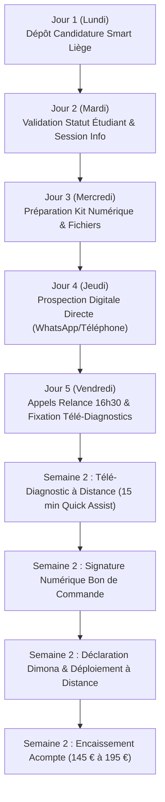

# PLAN D'ACTION OPÉRATIONNEL JOUR PAR JOUR (SEMAINE 1 & 2)
## Guide Pas-à-Pas 100% Numérique pour Brandon : Du Dépôt Smart au Premier Client Encaissé (Zéro Déplacement Physique)

---

### VUE D'ENSEMBLE DU CALENDRIER DE LANCEMENT (100% DISTANCIEL)



---

### SEMAINE 1 : SÉCURISATION ADMINISTRATIVE & PROSPECTION DIGITALE

#### JOUR 1 (LUNDI) — DÉPÔT FORMEL CHEZ SMART LIÈGE
- [ ] **Matin (9h00 - 10h30) :**
  1. Se connecter sur [smart.coop/fr/agenda](https://smart.coop/fr/agenda) et s'inscrire à la prochaine session d'information générale de Smart Liège (Blvd d'Avroy ou session en ligne).
  2. Se connecter sur le portail [studentatwork.be](https://www.studentatwork.be) via Itsme et télécharger l'attestation PDF du contingent des 600 heures.
  3. Récupérer l'attestation officielle d'inscription de l'établissement de promotion sociale (mentionnant le nombre d'heures / crédits hebdomadaires).
- [ ] **Après-midi (14h00 - 15h00) :**
  1. Ouvrir le fichier `DOSSIER_CANDIDATURE_SMART_LIEGE.md`.
  2. Compléter son nom, NISS, adresse et téléphone.
  3. Envoyer l'email officiel à `liege@smart.coop` avec les 4 pièces jointes :
     - Lettre de cadrage signée
     - Attestation Student@work ONSS
     - Attestation d'inscription promotion sociale
     - Carte d'identité recto-verso
- [ ] **Résultat attendu :** Accusé de réception de Smart Liège et fixation du rendez-vous d'accueil.

---

#### JOUR 2 (MARDI) — PRÉPARATION DES OUTILS NUMÉRIQUES
- [ ] **Matin (10h00 - 12h00) :**
  1. Vérifier que Python 3.12 et openpyxl sont bien opérationnels sur son PC.
  2. Lancer la suite de tests automatisés :
     ```powershell
     python test_btp_suite.py
     ```
     *(Tous les tests doivent afficher `OK` en vert).*
  3. Synchroniser sur un dossier OneDrive / Google Drive dédié :
     - `DEVIS_SANS_OUBLI_MODELE_PRO.xlsx`
     - `FICHIER_PROSPECTION_LIEGE_BTP.xlsx`
     - `PACK_BIENVENUE_ET_FORMATION_CLIENT.md`
     - `BON_DE_COMMANDE_PROPOSITION_COMMERCIALE.md`
- [ ] **Après-midi (14h00 - 16h00) :**
  1. Tester l'outil Quick Assist (Assistance Rapide Windows native) :
     - Appuyer sur `Touche Windows + Ctrl + Q`.
     - Générer un code de partage à 6 chiffres et tester la prise de main à distance en 60 secondes chrono.
  2. Préparer le modèle PDF numérique du bon de commande et le modèle d'email / message WhatsApp de confirmation de commande ("Bon pour accord").

---

#### JOUR 3 (MERCREDI) — QUALIFICATION DIGITALE DES PROSPECTS
- [ ] **Matin (9h00 - 11h30) :**
  1. Ouvrir le fichier `FICHIER_PROSPECTION_LIEGE_BTP.xlsx`.
  2. Vérifier les coordonnées des 5 premiers prospects ciblés :
     - Alain Renard (*Chauffage Meuse Confort*, Angleur)
     - Benoît Lambert (*Électricité Lambert & Fils*, Chaudfontaine)
     - Fabrice Martin (*Verviers Sanitaire Sprl*, Verviers)
     - Thierry Dumont (*Rénov Mosane*, Seraing)
     - Guy Collard (*Clim & Chauffage Herstal*, Herstal)
  3. Vérifier sur Google Maps, fiches Google My Business et Banque-Carrefour des Entreprises (BCE) que leurs numéros de portable direct et emails sont exacts.
- [ ] **Après-midi (14h00 - 16h30) :**
  1. Préparer les 5 messages vocaux personnalisés selon le script du `KIT_PROSPECTION_VENTE.md`.
  2. Répéter le script à haute voix (ton posé, confraternel, direct, zéro jargon commercial agressif).

---

#### JOUR 4 (JEUDI) — PROSPECTION DIGITALE DIRECTE : WHATSAPP & AUDIT VISUEL (100% DISTANCIEL)
- [ ] **Matin (9h30 - 11h30) :**
  1. Identifier 10 profils d'artisans actifs sur Google My Business et pages professionnelles en Wallonie / Liège.
  2. Repérer immédiatement les failles visibles : retards de devis signalés dans les avis, absence de réponse rapide, surcharge visible.
  3. Envoyer 5 vocaux WhatsApp personnalisés ultra-courts (35 secondes chrono) selon le script numérique :
     > *« Bonjour Alain, c'est Brandon. J'ai vu vos réalisations récentes en toiture, super travail. Petite question rapide : en ce moment, vous arrivez à envoyer vos devis en moins de 24h ou vous passez encore vos soirées et vos dimanches sur des fichiers compliqués ? J'aide les artisans wallons à sécuriser 100% de leurs devis en 4 minutes sans changer d'outils. Si vous avez 5 minutes à 16h30, je vous montre en partage d'écran rapide. »*
- [ ] **Après-midi (14h00 - 17h00) :**
  1. Noter les réponses et retours dans `FICHIER_PROSPECTION_LIEGE_BTP.xlsx`.
  2. Envoyer un lien direct de télé-diagnostic (15 min à distance) aux artisans qui répondent.

---

#### JOUR 5 (VENDREDI) — VENDREDI 16H30 : LE TEST TÉLÉPHONIQUE EN DIRECT
- [ ] **Fin d'après-midi (16h00 - 17h30) :**
  1. Appeler par téléphone les 3 prospects les plus chauds.
  2. C'est le moment exact où ils rentrent de chantier, fatigués, avec la perspective de passer leur week-end sur des devis :
     > *« Bonjour Alain, c'est Brandon. C'est juste pour savoir : ce week-end, vous avez combien de devis qui traînent sur votre bureau ? Si vous me donnez 15 minutes mardi à 17h30 en partage d'écran rapide (Quick Assist ou Google Meet), je vous montre comment ne plus jamais perdre un devis sans bouger de votre fauteuil. »*
  3. Verrouiller 2 rendez-vous de télé-diagnostic pour le début de semaine 2.

---

### SEMAINE 2 : TRANSFORMATION, CONTRAT & DÉPLOIEMENT À DISTANCE

#### JOUR 6 (MARDI SEMAINE 2) — LE TÉLÉ-DIAGNOSTIC À DISTANCE (15 MIN CHRONO)
- [ ] **Session à distance (12h30 ou 17h30) :**
  1. Ouvrir une session Quick Assist (Touche Windows + Ctrl + Q) ou Google Meet.
  2. Demander au patron : *« Donnez-moi juste les 3 derniers devis que vous avez envoyés le mois dernier. »*
  3. Les saisir sous ses yeux dans le tableau partagé : voir la colonne rouge "À RELANCER D'URGENCE" s'afficher.
  4. Appliquer le script de closing en 3 questions (`GUIDE_OBJECTIONS_ET_CLOSING_BTP.md`).
  5. Envoyer le `BON_DE_COMMANDE_PROPOSITION_COMMERCIALE.md` en PDF pour validation par retour d'email ou message WhatsApp écrit "Bon pour accord".
  6. Encaisser l'acompte de 50 % (par virement bancaire direct sur le compte Smart Coop).

---

#### JOUR 7 (MERCREDI SEMAINE 2) — DÉCLARATION SMART & DÉPLOIEMENT 100% DISTANCIEL
- [ ] **Matin : Déclaration légale préalable (Dimona) :**
  1. Se connecter sur le portail en ligne Smart Coop.
  2. Créer le contrat de mission avec les données du client (N° TVA, nom de l'entreprise).
  3. Fixer la date de prestation et encoder la déclaration **avant minuit la veille de l'intervention**.
- [ ] **Après-midi : Déploiement technique 100% à distance (45 min chrono) :**
  1. Connexion à distance sécurisée via Quick Assist (Touche Windows + Ctrl + Q).
  2. Déposer la matrice Excel sur le bureau PC de l'artisan et configurer la sauvegarde cloud automatique (OneDrive ou Google Drive).
  3. Envoyer le lien PWA sur son smartphone et créer le raccourci sur son écran d'accueil.
  4. Former l'artisan ou son assistante pendant 20 minutes sur un cas réel de devis.

---

#### JOUR 8 (JEUDI SEMAINE 2) — CLÔTURE & ENCAISSEMENT DU SOLDE
- [ ] **Validation finale :**
  1. Faire tester une saisie réelle par l'artisan lui-même sur son smartphone ou PC.
  2. Faire valider la réception du bon de livraison / PV de recette numérique par retour d'email.
  3. Émettre la facture finale de solde de 50 % via l'outil de facturation Smart.
  4. Envoyer le premier "Rapport Patron" de test généré par `generate_rapport_patron.py`.
- [ ] **Proposer le relais d'abonnement récurrent :**
  - Proposer le Pack 3 à 195 € HTVA / trimestre (65 €/mois) pour le suivi des sauvegardes et le rapport mensuel automatique.

---

### RÈGLES DE SURVIE POUR NE JAMAIS S'ÉPARPILLER (100% NUMÉRIQUE)

1. **Ne jamais baisser le prix sous 290 € HTVA :** En dessous, le budget Smart ne couvre pas le coût salarial journalier minimum légal de la CP 200.
2. **Ne jamais accepter de cash non déclaré :** Utiliser le script de refus élégant (`GUIDE_TERRAIN_FISCAL_ET_VENTE.md`). Facturation 100% officielle Smart avec TVA déductible pour l'artisan.
3. **Toujours déclarer la prestation sur le portail Smart AVANT de travailler :** L'ONSS interdit strictement les déclarations rétroactives.
4. **Déploiement 100% numérique et à distance :** Zéro temps perdu dans les embouteillages, zéro dépense d'essence ou de véhicule, compatibilité totale avec les études de promotion sociale (interventions le soir ou en fin de journée), et marché étendu à toute la Wallonie et Bruxelles.
