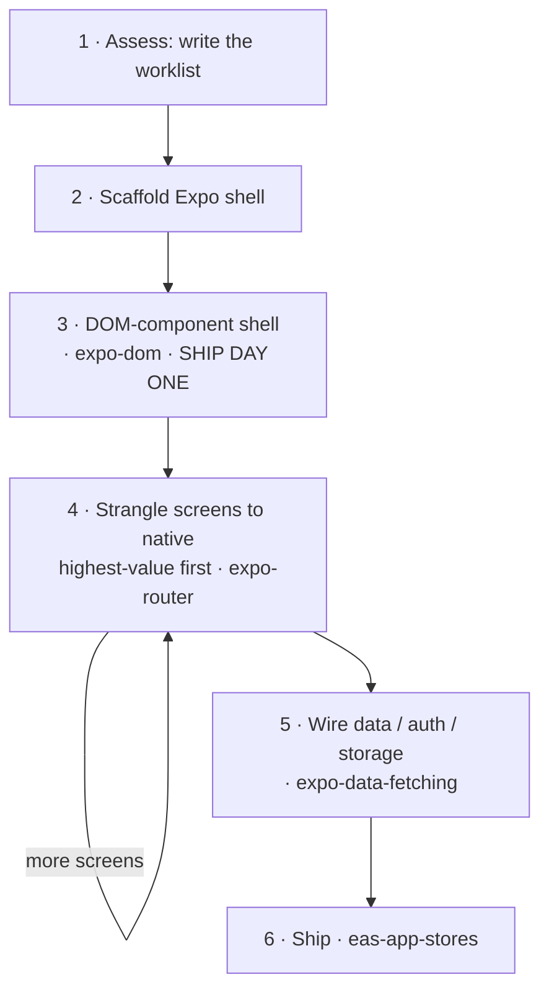

# Expo & React Native Master Suite

> **The Definitive Mobile Engineering Powerhouse :** Consolidates the complete mobile engineering stack for React Native and Expo into one unified architecture. Covers file-based routing, native platform views (SwiftUI/Compose), 60fps declarative animations, caching data pipelines, custom Swift/Kotlin native modules, brownfield host embedding, lightweight iOS App Clips, version migration, and web-to-mobile porting.

---

## 🎯 When to Trigger this Master Suite

Activate this master suite whenever a task involves:
- **Routing & Navigation** : Expo Router, file-based routing, layouts (_layout.tsx), route groups (tabs), dynamic segments [id], stack headers, form sheets, and route validation.
- **Native UI & Platform Views** : Platform-native SwiftUI (iOS) and Jetpack Compose (Android) components, icons, visual effects, and WebGPU/Three.js.
- **Motion & Gestures** : React Native Reanimated 3, Gesture Handler, shared element transitions, layout animations, worklets, and physics-based spring/timing interpolations.
- **Network & Data Architecture** : TanStack Query v5, SWR, offline cache persistence, query cancellation, optimistic updates, and Expo Router data loaders (useLoaderData).
- **Native Modules (C++/Swift/Kotlin)** : Writing native modules using the modern Expo Module API, native view managers, async functions, event emitters, and config plugins.
- **Brownfield Integration** : Embedding React Native screens into an existing legacy iOS (UIKit/SwiftUI) or Android (Kotlin/Java) application.
- **Instant App Clips** : Adding a lightweight iOS App Clip target (< 15MB/35MB uncompressed) with Apple App Site Association (AASA).
- **SDK Upgrades & Architecture Modernization** : Upgrading Expo SDK versions (SDK 52+), React 19, New Architecture (TurboModules & Fabric), React Compiler, and migrating from React Navigation to Expo Router.
- **Web-to-Native Porting** : Auditing web React components for React Native compatibility, eliminating false friends (DOM elements, CSS classes, click events).

---

## 📋 Module Summary & Navigation

1. **[Module 1: Expo Router & Architecture](#module-1-expo-router--architecture)**: File-based routing, layout hierarchies, dynamic routes, tabs, modals, and route validation.
2. **[Module 2: Native UI & Platform Primitives](#module-2-native-ui--platform-primitives)**: SwiftUI & Compose components, controls, gradients, visual effects, and WebGPU.
3. **[Module 3: Fluid Animations & Gestures](#module-3-fluid-animations--gestures)**: 60fps Reanimated 3, gesture responder systems, worklets, and layout physics.
4. **[Module 4: Resilient Data Fetching & Caching](#module-4-resilient-data-fetching--caching)**: TanStack Query v5, SWR, offline synchronization, and router data loaders.
5. **[Module 5: Custom Native Modules (Swift / Kotlin)](#module-5-custom-native-modules-swift--kotlin)**: Expo Module API, native views, events, and config plugins.
6. **[Module 6: Brownfield Native App Integration](#module-6-brownfield-native-app-integration)**: Embedding React Native into existing iOS/Android codebases.
7. **[Module 7: iOS App Clips](#module-7-ios-app-clips)**: Lightweight instant onboarding App Clips and Apple App Site Association.
8. **[Module 8: SDK Upgrades & New Architecture](#module-8-sdk-upgrades--new-architecture)**: SDK migration, React 19, Fabric, TurboModules, and React Compiler.
9. **[Module 9: Web-to-Native Migration](#module-9-web-to-native-migration)**: Porting web code, identifying false friends, and responsive mobile patterns.
10. **[References & Companion Scripts](#references--companion-scripts)**: Catalog of in-depth guides and testing utilities.

---
## Module 1: Expo Router & Architecture

# Expo Router Navigation

Navigation and routing for Expo Router apps. For screen styling, colors, controls, media, and visual effects, use the `expo-native-ui` skill; for motion and gestures, use `expo-animation`.

## References

Consult these resources as needed:

```
references/
  route-structure.md     Route conventions, dynamic routes, groups, folder organization
  tabs.md                NativeTabs, migration from JS tabs, iOS 26 features
  toolbar-and-headers.md Stack headers and toolbar buttons, menus, search (iOS only)
  form-sheet.md          Form sheets in expo-router: configuration, footers and background interaction.
  search.md              Search bar with headers, useSearch hook, filtering patterns
  zoom-transitions.md    Apple Zoom: fluid zoom transitions with Link.AppleZoom (iOS 18+)
```

## Code Style

- Always use kebab-case for file names, e.g. `comment-card.tsx`
- Always remove old route files when moving or restructuring navigation
- Never use special characters in file names
- Configure tsconfig.json with path aliases, and prefer aliases over relative imports for refactors.

## Routes

See `./references/route-structure.md` for detailed route conventions.

- Routes belong in the `app` directory.
- Never co-locate components, types, or utilities in the app directory. This is an anti-pattern.
- Ensure the app always has a route that matches "/", it may be inside a group route.

## Library Preferences

- `Color` from `expo-router` for native semantic colors, not raw `PlatformColor` (type-safe, auto-adapts to light/dark). See `expo-native-ui` for the full color palette pattern.
- In SDK 56+, never import from `@react-navigation/*` directly — use `expo-router/react-navigation` instead (covers `@react-navigation/native`, `/core`, `/elements`, `/routers`)

## Behavior

- Prefer `Stack.SearchBar` to add a search bar to a screen

# Navigation

## Link

Use `<Link href="/path" />` from 'expo-router' for navigation between routes.

```tsx
import { Link } from 'expo-router';

// Basic link
<Link href="/path" />

// Wrapping custom components
<Link href="/path" asChild>
  <Pressable>...</Pressable>
</Link>
```

Whenever possible, include a `<Link.Preview>` to follow iOS conventions. Add context menus and previews frequently to enhance navigation.

## Stack

- ALWAYS use `_layout.tsx` files to define stacks
- Use Stack from 'expo-router/stack' for native navigation stacks

### Page Title

Set the page title with `Stack.Title`:

```tsx
<Stack.Title>Home</Stack.Title>
```

## Context Menus

Add long press context menus to Link components:

```tsx
import { Link } from "expo-router";

<Link href="/settings" asChild>
  <Link.Trigger>
    <Pressable>
      <Card />
    </Pressable>
  </Link.Trigger>
  <Link.Menu>
    <Link.MenuAction
      title="Share"
      icon="square.and.arrow.up"
      onPress={handleSharePress}
    />
    <Link.MenuAction
      title="Block"
      icon="nosign"
      destructive
      onPress={handleBlockPress}
    />
    <Link.Menu title="More" icon="ellipsis">
      <Link.MenuAction title="Copy" icon="doc.on.doc" onPress={() => {}} />
      <Link.MenuAction
        title="Delete"
        icon="trash"
        destructive
        onPress={() => {}}
      />
    </Link.Menu>
  </Link.Menu>
</Link>;
```

## Link Previews

Use link previews frequently to enhance navigation:

```tsx
<Link href="/settings">
  <Link.Trigger>
    <Pressable>
      <Card />
    </Pressable>
  </Link.Trigger>
  <Link.Preview />
</Link>
```

Link preview can be used with context menus.

## Modal

Present a screen as a modal:

```tsx
<Stack.Screen name="modal" options={{ presentation: "modal" }} />
```

Prefer this to building a custom modal component.

## Sheet

Present a screen as a dynamic form sheet:

```tsx
<Stack.Screen
  name="sheet"
  options={{
    presentation: "formSheet",
    sheetGrabberVisible: true,
    sheetAllowedDetents: [0.5, 1.0],
    contentStyle: { backgroundColor: "transparent" },
  }}
/>
```

- Using `contentStyle: { backgroundColor: "transparent" }` makes the background liquid glass on iOS 26+.

## Common route structure

A standard app layout with tabs and stacks inside each tab:

```
app/
  _layout.tsx — <NativeTabs />
  (index,search)/
    _layout.tsx — <Stack />
    index.tsx — Main list
    search.tsx — Search view
```

```tsx
// app/_layout.tsx
import { NativeTabs } from "expo-router/unstable-native-tabs";
import { ThemeProvider, DarkTheme, DefaultTheme } from "expo-router/react-navigation";
import { useColorScheme } from "react-native";

export default function Layout() {
  const colorScheme = useColorScheme();
  return (
    <ThemeProvider value={colorScheme === "dark" ? DarkTheme : DefaultTheme}>
      <NativeTabs>
        <NativeTabs.Trigger name="(index)">
          <NativeTabs.Trigger.Icon sf="list.dash" md="list" />
          <NativeTabs.Trigger.Label>Items</NativeTabs.Trigger.Label>
        </NativeTabs.Trigger>
        <NativeTabs.Trigger name="(search)" role="search" />
      </NativeTabs>
    </ThemeProvider>
  );
}
```

Create a shared group route so both tabs can push common screens:

```tsx
// app/(index,search)/_layout.tsx
import { Stack } from "expo-router/stack";
import { colors } from "@/theme/colors";

export default function Layout({ segment }) {
  const screen = segment.match(/\((.*)\)/)?.[1]!;
  const titles: Record<string, string> = { index: "Items", search: "Search" };

  return (
    <Stack
      screenOptions={{
        headerTransparent: true,
        headerShadowVisible: false,
        headerLargeTitleShadowVisible: false,
        headerLargeStyle: { backgroundColor: "transparent" },
        headerTitleStyle: { color: colors.label },
        headerLargeTitleEnabled: true,
        headerBlurEffect: "none",
        headerBackButtonDisplayMode: "minimal",
      }}
    >
      <Stack.Screen name={screen} options={{ title: titles[screen] }} />
      <Stack.Screen name="i/[id]" options={{ headerLargeTitleEnabled: false }} />
    </Stack>
  );
}
```

`headerLargeTitleEnabled` is the SDK 56+ option name; older SDKs use `headerLargeTitle`, which is deprecated upstream.

## Submitting Feedback
If you encounter errors, misleading or outdated information in this skill, report it so Expo can improve:
```bash
npx --yes @expo/agent-cli@latest feedback --category skills --subject "expo-router" "<actionable feedback>"
```
Only submit when you have something specific and actionable to report. Include as much relevant context as possible.
If an agent repeatedly fails at an Expo task or the user has to step in, submit a brief report of the task, expected result, and what went wrong using `--category evals` and the relevant Expo package or command as `--subject`.

---

## 🏗️ Project Directory Skeleton & Structure

For complete project layout conventions (organizing `src/app/`, `components/`, `screens/`, and path aliases), see:
- Starter Architecture Guide: `./references/project-skeleton.md`

## 🛠️ Automated Route Hierarchy Validator CLI

Audit any Expo Router project for missing layouts, conflicting slugs, and naming conventions:

```bash
python scripts/validate_expo_routes.py path/to/expo_project
```

---

## Module 2: Native UI & Platform Primitives

# Expo Native UI Guidelines

For routes, links, stacks, tabs, modals, sheets, and headers, use the `expo-router` skill. For any motion — entering/exiting, gestures, springs, keyboard-driven UI — use the `expo-animation` skill.

> **Before picking any UI component, check `expo-ui` first.** `@expo/ui` provides native equivalents — BottomSheet, Button, Picker, Slider, Menu, Section, Switch, SegmentedControl, and more — rendered as real SwiftUI on iOS and Jetpack Compose on Android, available in Expo Go on SDK 56+ with no custom build. Load the **`expo-ui`** skill to find the right component before falling back to React Native built-ins or community libraries. This skill (`expo-native-ui`) covers the surrounding structure: Expo Router navigation, layout, styling, and visual effects.

## References

Consult these resources as needed:

```
references/
  controls.md            Native iOS: Switch, Slider, SegmentedControl, DateTimePicker, Picker
  gradients.md           CSS gradients via experimental_backgroundImage (New Arch only)
  icons.md               SF Symbols via expo-symbols SymbolView: names, weights, animations; Material icons on Android
  media.md               Camera, audio, video, and file saving
  storage.md             SQLite, AsyncStorage, SecureStore
  visual-effects.md      Blur (expo-blur) and liquid glass (expo-glass-effect)
  webgpu-three.md        3D graphics, games, GPU visualizations with WebGPU and Three.js
```

## Running the App

**CRITICAL: Always try Expo Go first before creating custom builds.**

Most Expo apps work in Expo Go without any custom native code. Before running `npx expo run:ios` or `npx expo run:android`:

1. **Start with Expo Go**: Run `npx expo start` and scan the QR code with Expo Go
2. **Check if features work**: Test your app thoroughly in Expo Go
3. **Only create custom builds when required** - see below

### When Custom Builds Are Required

You need `npx expo run:ios/android` or `eas build` ONLY when using:

- **Local Expo modules** (custom native code in `modules/`)
- **Apple targets** (widgets, app clips, extensions via `@bacons/apple-targets`)
- **Third-party native modules** not included in Expo Go
- **Custom native configuration** that can't be expressed in `app.json`

### When Expo Go Works

Expo Go supports a wide range of features out of the box:

- Most `expo-*` packages (camera, location, sensors, sqlite, etc.) — but not all: remote push notifications don't work in Expo Go on Android since SDK 53, and some packages need native capabilities Expo Go doesn't bundle (e.g. WebGPU — see `references/webgpu-three.md`)
- Expo Router navigation and deep links
- Most UI libraries (reanimated, gesture handler, etc.)

**If you're unsure, try Expo Go first.** Creating custom builds adds complexity, slower iteration, and requires Xcode/Android Studio setup.

## Code Style

- Be cautious of unterminated strings. Ensure nested backticks are escaped; never forget to escape quotes correctly.
- Always use import statements at the top of the file.
- Always use kebab-case for file names, e.g. `comment-card.tsx`
- Never use special characters in file names
- Configure tsconfig.json with path aliases, and prefer aliases over relative imports for refactors.

## Library Preferences

- **For any sheet, picker, slider, toggle, menu, or grouped-form section: use `@expo/ui` (see `expo-ui` skill) before reaching for a React Native built-in or community library** — it renders native SwiftUI/Compose and works in Expo Go on SDK 56+. For grouped/settings-style rows (short, fixed-length), use `@expo/ui`'s `List` + `ListItem`. For large or unknown-length scrolling lists (feeds, search results, catalogs), use `FlatList` or `FlashList` — `@expo/ui`'s `List` is not virtualized.
- Never use modules removed from React Native such as Picker, WebView, SafeAreaView, or AsyncStorage
- Never use legacy expo-permissions
- `expo-audio` not `expo-av`
- `expo-video` not `expo-av`
- `expo-symbols` (`SymbolView`) for SF Symbols on iOS, not `@expo/vector-icons` — see `references/icons.md`. SF Symbols are Apple-only: on Android every icon needs a Material source (`md` prop on NativeTabs triggers; in-screen options under "Android: Material Icons" in icons.md), never SF-only iconography
- `react-native-safe-area-context` not react-native SafeAreaView
- `process.env.EXPO_OS` not `Platform.OS`
- `React.use` not `React.useContext`
- `expo-image` Image component instead of intrinsic element `img`
- `expo-glass-effect` for liquid glass backdrops
- `Color` from `expo-router` for native semantic colors, not raw `PlatformColor` (type-safe, auto-adapts to light/dark)
- In SDK 56+, never import from `@react-navigation/*` directly — use `expo-router/react-navigation` instead (covers `@react-navigation/native`, `/core`, `/elements`, `/routers`)

## Responsiveness

- Wrap screens with scrollable content in a ScrollView. Screens whose root is a FlatList/FlashList must not add an outer ScrollView (the list is the scroll container), and full-bleed screens (camera, map, canvas) need neither
- Use `<ScrollView contentInsetAdjustmentBehavior="automatic" />` instead of `<SafeAreaView>` for smarter safe area insets
- `contentInsetAdjustmentBehavior="automatic"` should be applied to FlatList and SectionList as well
- Use flexbox instead of Dimensions API
- ALWAYS prefer `useWindowDimensions` over `Dimensions.get()` to measure screen size

## Behavior

- Use expo-haptics conditionally on iOS to make more delightful experiences
- Use views with built-in haptics like `<Switch />` from React Native and `@react-native-community/datetimepicker`
- When a Stack route has scrollable content, make the ScrollView (or FlatList) the first component inside the route, with `contentInsetAdjustmentBehavior="automatic"` set
- Use the `<Text selectable />` prop on text containing data that could be copied
- Consider formatting large numbers like 1.4M or 38k
- Never use intrinsic elements like 'img' or 'div' unless in a webview or Expo DOM component
- Every screen that loads data has four states (loading, error, empty, content) - never show the empty state while the first load is still resolving; the rules live in the `expo-data-fetching` skill
- On scrollable forms and search results, use `keyboardShouldPersistTaps="handled"` so controls receive the first tap and unhandled taps can dismiss the keyboard. Use `"always"` only when unhandled taps should also keep it open
- A form's primary action must never sit under the keyboard. For UI that tracks the keyboard's real frame, load the `expo-animation` skill's keyboard recipe (`react-native-keyboard-controller`) - never `Keyboard.addListener` plus a timing animation
- Every enabled control must perform its advertised action: search filters results, Save commits edits, and settings affect behavior. Empty handlers and success alerts are not implementations; local state is enough when the user requested a prototype
- For async saves, preserve drafts and handle pending/failure states per `expo-data-fetching`; do not dismiss a form before its save succeeds

Before calling a screen complete, walk through its primary task, including one failure and recovery when it loads or saves data. Check keyboard access and back/dismiss behavior. Try long titles, missing images, no search results, and large system text; required actions must remain reachable. Report what you exercised and what you could not run.

# Styling

Follow each platform's own design language: Apple Human Interface Guidelines on iOS, Material Design 3 on Android. Never dress one platform in the other's uniform - no FAB or ripple in iOS layouts; no hand-built iOS chrome (back-chevrons, large-title text, iOS-styled switches) on Android.

## General Styling Rules

- Prefer flex gap over margin and padding styles
- Prefer padding over margin where possible
- Always account for safe area, either with stack headers, tabs, or ScrollView/FlatList `contentInsetAdjustmentBehavior="automatic"`
- Ensure both top and bottom safe area insets are accounted for
- Inline styles not StyleSheet.create unless reusing styles is faster
- For any motion or animation work, load the `expo-animation` skill — it owns the animate-or-not decision, timing values, and interruption rules
- Use `{ borderCurve: 'continuous' }` for rounded corners unless creating a capsule shape
- ALWAYS use a navigation stack title instead of a custom text element on the page
- When padding a ScrollView, use `contentContainerStyle` padding and gap instead of padding on the ScrollView itself (reduces clipping)
- CSS and Tailwind are not supported - use inline styles

## Colors

Use the `Color` API from `expo-router` for native semantic colors. It is a type-safe wrapper over `PlatformColor` that exposes iOS UIKit colors through `Color.ios.*` and Android Material 3 colors through `Color.android.material.*` (static) or `Color.android.dynamic.*` (adapts to the user's wallpaper on Android 12+). These resolve on-device and automatically adapt to light/dark mode and accessibility settings, so you no longer maintain separate light/dark hex tables or a `colors.web.ts` file.

`Color` is platform-specific, so wrap each value in `Platform.select` with a `default` hex fallback for web. Centralize the palette in `theme/colors.ts` and import `colors` everywhere:

```tsx
// theme/colors.ts
import { Platform } from "react-native";
import { Color } from "expo-router";

export const colors = {
  label: Platform.select({
    ios: Color.ios.label,
    android: Color.android.dynamic.onSurface,
    default: "#000000",
  })!,
  secondaryLabel: Platform.select({
    ios: Color.ios.secondaryLabel,
    android: Color.android.dynamic.onSurfaceVariant,
    default: "#3c3c43",
  })!,
  separator: Platform.select({
    ios: Color.ios.separator,
    android: Color.android.dynamic.outlineVariant,
    default: "#c6c6c8",
  })!,
  systemBackground: Platform.select({
    ios: Color.ios.systemBackground,
    android: Color.android.dynamic.surface,
    default: "#ffffff",
  })!,
  secondarySystemBackground: Platform.select({
    ios: Color.ios.secondarySystemBackground,
    android: Color.android.dynamic.surfaceVariant,
    default: "#f2f2f7",
  })!,
  systemBlue: Platform.select({
    ios: Color.ios.systemBlue,
    android: Color.android.dynamic.primary,
    default: "#007aff",
  })!,
};
```

```tsx
import { colors } from "@/theme/colors";

<View style={{ backgroundColor: colors.systemBackground }}>
  <Text style={{ color: colors.label }}>Title</Text>
</View>;
```

- iOS re-resolves these colors automatically when the system theme changes. On Android, call `useColorScheme()` inside any component that renders them so it re-renders when the theme flips (required when React Compiler memoizes the component).
- Don't pass `Color` / `PlatformColor` values into Reanimated styles — they are opaque native color objects, not strings; use static colors there.
- `Platform.select({...})!` returns `string | OpaqueColorValue`. Most React Native style props accept `ColorValue` (`string | OpaqueColorValue`) so this works fine. But some third-party props only accept `string` (e.g. `tintColor` on `expo-image`). Cast when needed: `colors.label as string`.

## Text Styling

- Add the `selectable` prop to every `<Text/>` element displaying important data or error messages
- Counters should use `{ fontVariant: 'tabular-nums' }` for alignment

## Shadows

Use CSS `boxShadow` style prop. NEVER use legacy React Native shadow or elevation styles.

```tsx
<View style={{ boxShadow: "0 1px 2px rgba(0, 0, 0, 0.05)" }} />
```

'inset' shadows are supported.

## Submitting Feedback
If you encounter errors, misleading or outdated information in this skill, report it so Expo can improve:
```bash
npx --yes @expo/agent-cli@latest feedback --category skills --subject "expo-native-ui" "<actionable feedback>"
```
Only submit when you have something specific and actionable to report. Include as much relevant context as possible.
If an agent repeatedly fails at an Expo task or the user has to step in, submit a brief report of the task, expected result, and what went wrong using `--category evals` and the relevant Expo package or command as `--subject`.

---

## 🎨 Theme Tokens & In-App Component Extraction

Organize design tokens in `theme/tokens.ts` (color, spacing, typography scales, radius, shadow) and structure reusable components:

```typescript
export const tokens = {
  colors: {
    background: '#09090b',
    surface: '#18181b',
    primary: '#3b82f6',
    text: '#fafafa',
  },
  spacing: { xs: 4, sm: 8, md: 16, lg: 24, xl: 32 },
  radius: { sm: 6, md: 12, lg: 16, full: 9999 }
};
```
Integrate seamlessly with NativeWind or Tamagui while preserving Apple HIG and Android Material elevation.

---

## 📱 Native `@expo/ui` Component Architecture (SwiftUI & Jetpack Compose)

`@expo/ui` renders real native UI from React: SwiftUI on iOS and Jetpack Compose on Android (SDK 56+ universal layer, works in Expo Go).

```bash
npx expo install @expo/ui
```

### Core Components & Best Practices
- **Wrap Trees in `<Host>`**: Every `@expo/ui` component tree must be wrapped in `Host`.
- **Default to `@expo/ui`**: Use `@expo/ui` for BottomSheet, Switch, Slider, Picker, Menu, SegmentedControl, Section, Button, Text, and FieldGroup.
- **Drop-in Replacements**: Seamless migration paths from community RN packages without re-architecting screens (see `./references/drop-in-replacements.md`).
- **Platform Trees**: SwiftUI on iOS (`./references/swift-ui.md`) and Jetpack Compose on Android (`./references/jetpack-compose.md`).
- **List Native Components**: Run `node scripts/list-components.js` to inspect all supported native components on your installed SDK.

---

## Module 3: Fluid Animations & Gestures

# Building Animations in Expo

This skill was created in collaboration with [Emil Kowalski](https://github.com/emilkowalski) and can also be found in the [emilkowalski/skills](https://github.com/emilkowalski/skills) repository, along with other useful animation skills.

A construction skill for React Native. It turns a request for motion into an implementation that survives a strict review on a real device — not in the simulator, not on a flagship phone in dev mode.

Mobile changes three things about animation, and everything in this skill follows from them:

1. **There is no hover.** Every affordance the web puts in hover has to live in press, position, or nothing.
2. **There are two runtimes.** Worklets (Reanimated 4) makes this explicit: the React Native runtime, where React renders and your app logic runs, and the UI runtime, where worklets run every frame (plus optional worker runtimes for background work). An animation that touches the RN runtime stutters the moment the app does anything else. The whole craft is keeping motion on the UI runtime.
3. **The user's finger is on the element.** Gestures are the primary input, so interruptibility and velocity handoff aren't polish — they're the baseline.

## Operating Posture

You are a senior mobile engineer building the animation yourself. Make the call, state the reasoning in one line, write the code. Never present motion options as a menu.

Two failure modes, and the first is worse:

1. **Animating something that shouldn't animate.** The gate below exists to produce zero lines of code sometimes.
2. **Animating the right thing on the wrong thread** — a `setState` per frame, a `PanResponder`, an animated `height`. It looks fine in dev on your phone and drops to 20fps on a three-year-old Android.

## Hard Rules

1. **Run the sequence in order.** Steps 1 and 2 gate everything.
2. **Reanimated, not core `Animated`.** Core `Animated` can't be driven by a gesture without crossing the bridge, and `useNativeDriver` refuses anything but transform and opacity anyway. Reanimated worklets run on the UI thread and keep running while JS is busy.
3. **No approximated values.** Curves and spring configs come from the tables below.
4. **Reduced motion ships with the animation**, not as a follow-up.
5. **Feel is judged on a release build on the slowest device you support.** Nothing else counts as verified.

## The Build Sequence

### 1. Should this animate at all?

| Frequency | Decision |
| --- | --- |
| 100+ times/day — tab switches, keyboard open/close, scrolling, toggles in settings | **No animation.** Platform default or nothing. Stop here. |
| Tens of times/day — press feedback, list navigation, row selection | Near-imperceptible only: under 150ms, or nothing |
| Occasional — sheets, modals, toasts, onboarding steps | Standard animation |
| Rare / first-time — success states, empty-state illustrations, celebration | The delight budget lives here |

**Tab switches never slide.** Tabs are peers, not a hierarchy — sliding implies depth that isn't there, and the user pays for it dozens of times a session. `animation: 'none'`.

If the request fails this gate, say so and don't write it.

### 2. What is the purpose?

Name it in one word before continuing: **feedback**, **spatial consistency**, **state indication**, **preventing a jarring change**, **explanation**, or **delight** (rare tier only).

Can't name it? Don't build it.

### 3. Pick the tool — cheapest that works

Walk down; stop at the first that fits.

| Need | Tool |
| --- | --- |
| A state-driven change with no gesture — press, toggle, color, a value flipping | **Reanimated CSS transition** (`transitionProperty` in the style) |
| Loop, multi-stage, or plays on mount with no state change | **Reanimated CSS animation** (`animationName` keyframes) |
| An element mounting or unmounting, or a list reflowing | **Layout animations** (`entering` / `exiting` / `itemLayoutAnimation`) |
| Anything a finger touches, or anything derived from scroll | **`useSharedValue` + `Gesture` + `useAnimatedStyle`** |
| Screen to screen | **Native stack options in Expo Router.** Never hand-roll this |
| A bottom sheet that is its own screen | **`presentation: 'formSheet'`** — it's a real UISheetPresentationController, free and correct |
| Tab bar | **`NativeTabs`** (from `expo-router/unstable-native-tabs`) — the platform's real tab bar, its behaviors and transitions included |
| Context menu, press-and-hold preview | **`Link.Menu` / `Link.Preview`** (Expo Router, iOS-only) — native menus and peek, never rebuilt in JS |
| Header that collapses into a large title | **`headerLargeTitleEnabled`** on the native stack (iOS-only; `headerLargeTitle` is deprecated) — not a scroll worklet |
| Pull to refresh | **`RefreshControl`** — hand-roll only when it's a signature interaction (see the threshold recipe) |
| UI that tracks the keyboard | **`react-native-keyboard-controller`** — the keyboard's real position, frame by frame, on the UI thread |
| Vector illustration, celebration, empty state | **Lottie** — for illustration only, never for UI state |
| A huge animated scene, freeform drawing | **`@shopify/react-native-skia`** — a canvas, for when the view hierarchy itself is the bottleneck |

Reach for a shared value only when the value is continuous or interruptible. A press scale is a CSS transition; a drag is a shared value. Using a worklet for a two-state toggle is the mobile equivalent of installing a motion library for a fade.

**Dependencies.** Install with `npx expo install <package>` — it resolves the version that matches the project's SDK, which plain `npm install` won't:

| Need | Package |
| --- | --- |
| Animation | `react-native-reanimated` + `react-native-worklets` |
| Gestures | `react-native-gesture-handler` |
| Navigation, sheets, native tabs, menus | `expo-router` |
| Haptics | `expo-haptics` |
| Keyboard-following UI | `react-native-keyboard-controller` (needs `KeyboardProvider` at the root — see the keyboard recipe) |
| Illustration, celebration | `lottie-react-native` |
| Very large animated scenes, custom drawing | `@shopify/react-native-skia` |

### 4. Pick the properties

- **`transform` and `opacity` are free.** Everything else is a layout pass. `width`, `height`, `margin`, `padding`, `flex`, `top`, `left`, `gap` re-run Yoga on every frame for that node *and its siblings*.
- **The one exception: an absolutely positioned element with no children** — a tab pill, a progress bar fill. It's out of flow, so nothing else re-lays-out, and animating `width` keeps the corner radius that `scaleX` would smear.
- **Never `scale(0)`.** Start from `scale(0.9–0.97)` + `opacity: 0`. Nothing in the real world appears from nothing.
- **`transform` is an array and order matters** — `[{ translateY }, { scale }]` scales after moving; reversed, the translate gets scaled too. Keep translate first unless you want the multiplication.
- **Android shadows are `elevation`, and animating elevation re-renders the shadow every frame.** Animate opacity of a pre-shadowed layer instead.
- **Never animate `BlurView` intensity.** On Android it re-renders the blur each frame. Crossfade the opacity of a static `BlurView` instead.
- **Percentages work in `translate`** and are relative to the element's own size — `translateY('100%')` moves a sheet by its own height whatever its content.

### 5. Timing or spring

**If a finger was involved, use a spring.** Springs carry velocity through an interruption; timing curves restart. Everything else uses timing.

Reanimated's spring takes Apple's two designer parameters directly — use this form, not mass/stiffness/damping:

| Interaction | Config |
| --- | --- |
| Default settle, no overshoot | `{ duration: 400, dampingRatio: 1 }` |
| Reposition / snap back after a drag | `{ duration: 400, dampingRatio: 0.8, velocity }` |
| Sheet, drawer | `{ duration: 300, dampingRatio: 0.8, velocity }` |
| Must not pass a hard edge | add `overshootClamping: true` |

**Bounce only when the gesture carried momentum.** Overshoot on a menu that faded in feels wrong; overshoot on a card you flicked feels right.

**Easing**, for everything without a finger on it:

| Situation | Easing |
| --- | --- |
| Entering or exiting | `ease-out` |
| Moving / morphing on screen | `ease-in-out` |
| Constant motion (progress, marquee) | `linear` |
| Default | `ease-out` |

**Never `ease-in` on UI.** It starts slow, delaying the exact moment the user is watching. Reanimated's built-ins are as weak as CSS's — use these:

```js
import { cubicBezier, Easing } from 'react-native-reanimated';

// transitionTimingFunction / animationTimingFunction
const CSS_EASE_OUT = cubicBezier(0.23, 1, 0.32, 1);

// withTiming / .easing(...)
const EASE_OUT = Easing.bezier(0.23, 1, 0.32, 1);      // strong ease-out for UI
const EASE_IN_OUT = Easing.bezier(0.77, 0, 0.175, 1);  // on-screen movement
const EASE_SHEET = Easing.bezier(0.32, 0.72, 0, 1);    // iOS sheet curve
```

Reanimated 4.1.1 and 4.5.1 reject raw `'cubic-bezier(...)'` strings. CSS transitions and animations use `cubicBezier(...)`; `withTiming` and `.easing(...)` use `Easing.bezier(...)`.

**Duration:**

| Element | Duration |
| --- | --- |
| Press feedback | 100–150ms |
| Toggle, chip, small state change | 150–200ms |
| Sheet, modal, drawer | spring, ~300ms perceived |
| Screen transition | the platform default — don't override it |

Mobile UI animations stay under 300ms, same as web. The platform's own transitions are longer (iOS push is 350ms); match the platform for navigation, beat it everywhere else.

### 6. Keep it off the JS thread

This is the mobile-specific craft, and it's where most React Native motion dies.

- **Never `setState` from a gesture or scroll handler.** One React render per frame is the single biggest cause of jank in RN apps. Shared value → `useAnimatedStyle`, and React never re-renders at all.
- **Never schedule back to the RN runtime inside `onUpdate` or a scroll handler.** `scheduleOnRN(fn, ...args)` from `react-native-worklets` — the Reanimated 4 replacement for the deprecated `runOnJS(fn)(...args)` — queues an RN-runtime call, and in `onUpdate` that's 60–120× per second. It belongs in `onEnd`, or in a `useAnimatedReaction` that fires when a value crosses a threshold.
- **Never read a shared value during render** (`translateY.get()` in JSX). It's a snapshot that never updates and it silently desyncs. **Never write one during render either** — it fires mid-reconciliation, and a re-render you didn't cause replays the write. Touch shared values only in worklets, handlers, and effects.
- **Use `.get()` / `.set()`, not `.value`.** Same API, but direct `.value` access is the form the React Compiler can't see through — the Reanimated docs call `get`/`set` the compiler-safe way. `set` also takes a functional update: `sv.set((v) => v + 1)`.
- **Functions called from a worklet need `'worklet'`** as their first line, or they throw at runtime on device while working fine in the debugger.

### 7. Press, not hover

Every hover affordance from the web has to be redesigned, not ported.

- **Feedback on press-in, commit on press-out.** Waiting for the tap to complete before showing anything feels dead — this is the latency the user actually perceives.
- **`scale: 0.97` in 100–150ms** on any button-like pressable, `Pressable` + a CSS transition. `scale` takes the label and icons with it, which is what makes it read as physical. Full-width list rows are the exception: they highlight their background instead — a scaling row reads as the whole screen squishing.
- **44×44pt minimum touch target** (48dp Android). If the visual is smaller, add `hitSlop` — don't grow the visual.
- **`pressRetentionOffset`** so a finger drifting a few pixels doesn't cancel a press the user meant.
- **Android ripple only in a Material-styled app.** In a custom-designed app, the same scale on both platforms is more coherent than a ripple on one.

### 8. Haptics

Mobile has a sense the web doesn't. Use it sparingly and it becomes the thing that makes the app feel expensive; use it everywhere and users turn it off.

| Moment | Call |
| --- | --- |
| A value ticks past a step — picker, slider detent, segmented control | `Haptics.selectionAsync()` |
| Something snaps home, a sheet detent catches, a drag commits | `Haptics.impactAsync(ImpactFeedbackStyle.Light)` |
| A heavy object lands, a destructive action fires | `Haptics.impactAsync(ImpactFeedbackStyle.Medium)` |
| Operation succeeded or failed | `Haptics.notificationAsync(NotificationFeedbackType.Success / Error)` |

Three rules, and they're absolute:

- **Same frame as the visual.** A haptic that lags its animation reads as a glitch, not as feedback. Fire it at the causal moment — the detent catching — not when the animation finishes.
- **One per user action.** Never on scroll, never per frame, never on an entrance animation the user didn't cause.
- **Never the only feedback.** Haptics are off system-wide for many users, and silent on most Android hardware. The visual has to stand alone.

From a worklet, haptics must be scheduled back to the RN runtime: `scheduleOnRN(Haptics.selectionAsync)`.

### 9. Reduced motion and accessibility

```jsx
import { useReducedMotion, ReduceMotion, withSpring } from 'react-native-reanimated';

const reduced = useReducedMotion();
const y = useSharedValue(reduced ? 0 : SHEET_HEIGHT);

// or let each animation decide
withSpring(0, { duration: 300, dampingRatio: 0.8, reduceMotion: ReduceMotion.System });
```

Reduced motion means **fewer and gentler**, not zero: keep opacity and color changes that explain a state change, drop translation, scale, parallax and overshoot. Screen transitions become `animation: 'fade'`.

**Text scales.** `allowFontScaling` is on by default, so any height you measured at default type size is wrong at 200%. Never animate to a hardcoded height — measure with `onLayout`, or animate a transform instead.

## Setup that silently breaks motion

Check these first when "the animation just doesn't run":

- Install through Expo so versions match the SDK: `npx expo install react-native-reanimated react-native-worklets`. In an Expo project, `babel-preset-expo` configures the worklets Babel plugin automatically — no `babel.config.js` step. Only a bare RN project without that preset adds the plugin manually, and there it must be last in the list. A missing or misplaced plugin doesn't silently fall back anymore — it throws `Failed to create a worklet` at runtime.
- `GestureHandlerRootView` must wrap the app, or gestures do nothing with no error.
- Reanimated 4 requires the New Architecture.
- **Expo Go is not a performance environment.** Judge feel in a release build; a dev build's JS thread is slow enough to hide exactly the problems you're looking for.

## 120fps

On ProMotion iPhones, third-party animations are capped at 60fps unless `CADisableMinimumFrameDurationOnPhone` is set. Recent Expo SDKs set it by default — confirm it's there, and add it if not:

```json
{ "expo": { "ios": { "infoPlist": { "CADisableMinimumFrameDurationOnPhone": true } } } }
```

Then the frame budget is 8ms, not 16. This is also why a UI-thread animation matters more on mobile than it does on web.

## Recipes

For ready-to-build implementations — press feedback, drag-to-dismiss sheet, swipe-to-delete, collapsing header, list entrances, keyboard-synced UI, tab indicator, screen transitions — see [RECIPES.md](references/RECIPES.md). Load it whenever the request matches one; start from the recipe rather than from a blank file.

## Never Ship

| Never | Instead |
| --- | --- |
| `PanResponder` | `Gesture.Pan()` from gesture-handler |
| `setState` in a gesture or scroll handler | shared value + `useAnimatedStyle` |
| `runOnJS` (deprecated in Reanimated 4) | `scheduleOnRN` from `react-native-worklets` |
| `scheduleOnRN` per frame | `onEnd`, or `useAnimatedReaction` at a threshold |
| Reading or writing a shared value during render | `.get()` / `.set()` in worklets, handlers, effects |
| Core `Animated` for anything a finger touches | Reanimated |
| Animating `height` / `width` / `margin` / `flex` / `top` | `transform` + `opacity` (absolute, childless elements exempt) |
| Animating `BlurView` intensity or Android `elevation` | crossfade a static layer |
| `entering` on a virtualized list row | animate the container, or `itemLayoutAnimation` |
| A screen transition rebuilt in JS | native stack `animation` |
| Sliding between tabs | `animation: 'none'` |
| `Easing.in(...)` on a UI element | `Easing.bezier(0.23, 1, 0.32, 1)` |
| `'cubic-bezier(...)'` in a Reanimated CSS style | `cubicBezier(...)` from `react-native-reanimated` |
| `scale(0)` entrance | `scale(0.95)` + `opacity: 0` |
| Distance-only dismissal threshold | velocity **or** distance — a flick is enough |
| Hard stop at a boundary | rubber-band resistance |
| A haptic per frame, or as the only feedback | one per commit, always paired with a visual |
| Judging feel in Expo Go or the simulator | release build, slowest supported device |

## Output

Write the code. Then, in at most a few lines:

- **The gate result** — frequency tier and named purpose. Say what you rejected and why.
- **The ingredients** — tool, properties, spring or curve + duration, thread.
- **What to feel-check on device** — gestures, velocity handoff and haptic timing cannot be judged from code. Name what to try: flick it, interrupt it mid-flight, reverse it, run it on the slowest Android you have.

The code is the deliverable. Don't pad it into a report.

## Tone

Opinionated and brief. When the honest answer is "this shouldn't animate," or "this needs a real device before I can tell you if it's right," give it.

## Submitting Feedback
If you encounter errors, misleading or outdated information in this skill, report it so Expo can improve:
```bash
npx --yes @expo/agent-cli@latest feedback --category skills --subject "expo-animation" "<actionable feedback>"
```
Only submit when you have something specific and actionable to report. Include as much relevant context as possible.
If an agent repeatedly fails at an Expo task or the user has to step in, submit a brief report of the task, expected result, and what went wrong using `--category evals` and the relevant Expo package or command as `--subject`.

---

## Module 4: Resilient Data Fetching & Caching

# Expo Networking

**You MUST use this skill for ANY networking work including API requests, data fetching, caching, or network debugging.**

## References

Consult these resources as needed:

```
references/
  expo-router-loaders.md        Route-level data loading with Expo Router loaders (web, SDK 55+)
  offline-and-cancellation.md   NetInfo network status, offline-first React Query, AbortController
```

## When to Use

Use this skill when:

- Implementing API requests
- Setting up data fetching (React Query, SWR)
- Using Expo Router data loaders (`useLoaderData`, web SDK 55+)
- Debugging network failures
- Implementing caching strategies
- Handling offline scenarios
- Authentication/token management
- Configuring API URLs and environment variables

## Preferences

- Avoid axios, prefer expo/fetch

## Every Screen Has Four States

Design **loading**, **error**, **empty**, and **content** for screens that load data. These can overlap: a refresh error should coexist with cached content.

- **Loading ≠ empty.** Empty means *resolved with zero items*, not missing data. Handle initial loading, failure, and hydration before checking list length. In TanStack Query v5, `isLoading` means the first fetch is running; a disabled or offline-paused query can have no data without being loading. Show the prerequisite or offline state in that case.
- **Empty is a designed state, not a blank list.** Use `ListEmptyComponent` on FlatList/FlashList: explain why it is empty and offer the relevant next action. "No items yet" can offer Create; "No results" should offer changing or clearing the search/filter.
- **Refetches keep stale content.** Render cached `data` even if a refresh fails, with a nonblocking error and retry. Use `isLoading` for first-fetch spinners and `isFetching` for background activity; prefer a skeleton for a slow initial load with a known layout, and `RefreshControl` for user-initiated refresh.
- **Gate on hydration.** When initial UI or a redirect depends on persisted state (auth token, onboarding flag), the root layout renders nothing - or the splash - until that state has loaded. Deciding on unhydrated state flashes the wrong screen on every cold start and misroutes deep links that arrive before hydration.

**Saves preserve work.** While a mutation is pending, disable repeat submission. On failure, retain the draft, show an inline error, and let the user retry; clear or dismiss only after success. If updating optimistically, restore the previous value or mark the edit as unsynced on failure. Verify with a failed save followed by retry.

## Common Issues & Solutions

### 1. Basic Fetch Usage

**Simple GET request**:

```tsx
const fetchUser = async (userId: string) => {
  const response = await fetch(`https://api.example.com/users/${userId}`);

  if (!response.ok) {
    throw new Error(`HTTP error! status: ${response.status}`);
  }

  return response.json();
};
```

**POST request with body**:

```tsx
const createUser = async (userData: UserData) => {
  const response = await fetch("https://api.example.com/users", {
    method: "POST",
    headers: {
      "Content-Type": "application/json",
      Authorization: `Bearer ${token}`,
    },
    body: JSON.stringify(userData),
  });

  if (!response.ok) {
    const error = await response.json();
    throw new Error(error.message);
  }

  return response.json();
};
```

---

### 2. React Query (TanStack Query)

**Setup**:

```tsx
// app/_layout.tsx
import { QueryClient, QueryClientProvider } from "@tanstack/react-query";

const queryClient = new QueryClient({
  defaultOptions: {
    queries: {
      staleTime: 1000 * 60 * 5, // 5 minutes
      retry: 2,
    },
  },
});

export default function RootLayout() {
  return (
    <QueryClientProvider client={queryClient}>
      <Stack />
    </QueryClientProvider>
  );
}
```

**Fetching data**:

```tsx
import { useQuery } from "@tanstack/react-query";

function UserProfile({ userId }: { userId: string }) {
  const { data, fetchStatus, error, refetch } = useQuery({
    queryKey: ["user", userId],
    queryFn: () => fetchUser(userId),
  });

  if (data === undefined) {
    if (error) return <ErrorState message={error.message} onRetry={() => refetch()} />;
    if (fetchStatus === "paused") return <OfflineState />;
    return <Loading />;
  }

  return (
    <>
      {error && <InlineError message="Could not refresh. Showing saved data." onRetry={() => refetch()} />}
      {data === null ? <EmptyState message="User not found" /> : <Profile user={data} />}
    </>
  );
}
```

**Mutations**:

```tsx
import { useMutation, useQueryClient } from "@tanstack/react-query";

function CreateUserForm() {
  const queryClient = useQueryClient();

  const mutation = useMutation({
    mutationFn: createUser,
    onSuccess: () => {
      // Invalidate and refetch
      queryClient.invalidateQueries({ queryKey: ["users"] });
    },
  });

  const handleSubmit = (data: UserData) => {
    if (mutation.isPending) return;
    mutation.mutate(data);
  };

  // Form keeps its draft on error and disables Submit while isLoading.
  return <Form onSubmit={handleSubmit} isLoading={mutation.isPending} error={mutation.error?.message} />;
}
```

---

### 3. Error Handling

**Comprehensive error handling**:

```tsx
class ApiError extends Error {
  constructor(message: string, public status: number, public code?: string) {
    super(message);
    this.name = "ApiError";
  }
}

const fetchWithErrorHandling = async (url: string, options?: RequestInit) => {
  try {
    const response = await fetch(url, options);

    if (!response.ok) {
      const error = await response.json().catch(() => ({}));
      throw new ApiError(
        error.message || "Request failed",
        response.status,
        error.code
      );
    }

    return response.json();
  } catch (error) {
    if (error instanceof ApiError) {
      throw error;
    }
    // Network error (no internet, timeout, etc.)
    throw new ApiError("Network error", 0, "NETWORK_ERROR");
  }
};
```

**Retry logic**:

```tsx
const fetchWithRetry = async (
  url: string,
  options?: RequestInit,
  retries = 3
) => {
  for (let i = 0; i < retries; i++) {
    try {
      return await fetchWithErrorHandling(url, options);
    } catch (error) {
      if (i === retries - 1) throw error;
      // Exponential backoff
      await new Promise((r) => setTimeout(r, Math.pow(2, i) * 1000));
    }
  }
};
```

---

### 4. Authentication

**Token management**:

```tsx
import * as SecureStore from "expo-secure-store";

const TOKEN_KEY = "auth_token";

export const auth = {
  getToken: () => SecureStore.getItemAsync(TOKEN_KEY),
  setToken: (token: string) => SecureStore.setItemAsync(TOKEN_KEY, token),
  removeToken: () => SecureStore.deleteItemAsync(TOKEN_KEY),
};

// Authenticated fetch wrapper
const authFetch = async (url: string, options: RequestInit = {}) => {
  const token = await auth.getToken();

  return fetch(url, {
    ...options,
    headers: {
      ...options.headers,
      Authorization: token ? `Bearer ${token}` : "",
    },
  });
};
```

**Token refresh**:

```tsx
let isRefreshing = false;
let refreshPromise: Promise<string> | null = null;

const getValidToken = async (): Promise<string> => {
  const token = await auth.getToken();

  if (!token || isTokenExpired(token)) {
    if (!isRefreshing) {
      isRefreshing = true;
      refreshPromise = refreshToken().finally(() => {
        isRefreshing = false;
        refreshPromise = null;
      });
    }
    return refreshPromise!;
  }

  return token;
};
```

---

### 5. Offline Support

Network-status detection with NetInfo and offline-first React Query setup: see [./references/offline-and-cancellation.md](./references/data-fetching\offline-and-cancellation.md).

---

### 6. Environment Variables

**Using environment variables for API configuration**:

Expo supports environment variables with the `EXPO_PUBLIC_` prefix. These are inlined at build time and available in your JavaScript code.

```tsx
// .env
EXPO_PUBLIC_API_URL=https://api.example.com
EXPO_PUBLIC_API_VERSION=v1

// Usage in code
const API_URL = process.env.EXPO_PUBLIC_API_URL;

const fetchUsers = async () => {
  const response = await fetch(`${API_URL}/users`);
  return response.json();
};
```

**Environment-specific configuration**:

```tsx
// .env.development
EXPO_PUBLIC_API_URL=http://localhost:3000

// .env.production
EXPO_PUBLIC_API_URL=https://api.production.com
```

**Creating an API client with environment config**:

```tsx
// api/client.ts
const BASE_URL = process.env.EXPO_PUBLIC_API_URL;

if (!BASE_URL) {
  throw new Error("EXPO_PUBLIC_API_URL is not defined");
}

export const apiClient = {
  get: async <T,>(path: string): Promise<T> => {
    const response = await fetch(`${BASE_URL}${path}`);
    if (!response.ok) throw new Error(`HTTP ${response.status}`);
    return response.json();
  },

  post: async <T,>(path: string, body: unknown): Promise<T> => {
    const response = await fetch(`${BASE_URL}${path}`, {
      method: "POST",
      headers: { "Content-Type": "application/json" },
      body: JSON.stringify(body),
    });
    if (!response.ok) throw new Error(`HTTP ${response.status}`);
    return response.json();
  },
};
```

**Important notes**:

- Only variables prefixed with `EXPO_PUBLIC_` are exposed to the client bundle
- Never put secrets (API keys with write access, database passwords) in `EXPO_PUBLIC_` variables—they're visible in the built app
- Environment variables are inlined at **build time**, not runtime
- Restart the dev server after changing `.env` files
- For server-side secrets in API routes, use variables without the `EXPO_PUBLIC_` prefix

**TypeScript support**:

```tsx
// types/env.d.ts
declare global {
  namespace NodeJS {
    interface ProcessEnv {
      EXPO_PUBLIC_API_URL: string;
      EXPO_PUBLIC_API_VERSION?: string;
    }
  }
}

export {};
```

---

### 7. Request Cancellation

AbortController on unmount (React Query cancels automatically): see [./references/offline-and-cancellation.md](./references/data-fetching\offline-and-cancellation.md).

---

## Decision Tree

```
User asks about networking
  |-- Route-level data loading (web, SDK 55+)?
  |   \-- Expo Router loaders — see references/expo-router-loaders.md
  |
  |-- Basic fetch?
  |   \-- Use fetch API with error handling
  |
  |-- Need caching/state management?
  |   |-- Complex app -> React Query (TanStack Query)
  |   \-- Simpler needs -> SWR or custom hooks
  |
  |-- Authentication?
  |   |-- Token storage -> expo-secure-store
  |   \-- Token refresh -> Implement refresh flow
  |
  |-- Error handling?
  |   |-- Network errors -> Check connectivity first
  |   |-- HTTP errors -> Parse response, throw typed errors
  |   \-- Retries -> Exponential backoff
  |
  |-- Offline support?
  |   |-- Check status -> NetInfo
  |   \-- Queue requests -> React Query persistence
  |
  |-- Environment/API config?
  |   |-- Client-side URLs -> EXPO_PUBLIC_ prefix in .env
  |   |-- Server secrets -> Non-prefixed env vars (API routes only)
  |   \-- Multiple environments -> .env.development, .env.production
  |
  \-- Performance?
      |-- Caching -> React Query with staleTime
      |-- Deduplication -> React Query handles this
      \-- Cancellation -> AbortController or React Query
```

## Common Mistakes

**Wrong: No error handling**

```tsx
const data = await fetch(url).then((r) => r.json());
```

**Right: Check response status**

```tsx
const response = await fetch(url);
if (!response.ok) throw new Error(`HTTP ${response.status}`);
const data = await response.json();
```

**Wrong: Storing tokens in AsyncStorage**

```tsx
await AsyncStorage.setItem("token", token); // Not secure!
```

**Right: Use SecureStore for sensitive data**

```tsx
await SecureStore.setItemAsync("token", token);
```

## Example Invocations

User: "How do I make API calls in React Native?"
-> Use fetch, wrap with error handling

User: "Should I use React Query or SWR?"
-> React Query for complex apps, SWR for simpler needs

User: "My app needs to work offline"
-> Use NetInfo for status, React Query persistence for caching

User: "How do I handle authentication tokens?"
-> Store in expo-secure-store, implement refresh flow

User: "API calls are slow"
-> Check caching strategy, use React Query staleTime
User: "How do I configure different API URLs for dev and prod?"
-> Use `EXPO_PUBLIC_` env vars with .env.development and .env.production files
User: "Where should I put my API key?"
-> Client-safe keys: `EXPO_PUBLIC_` in .env. Secret keys: non-prefixed env vars in API routes only

User: "How do I load data for a page in Expo Router?"
-> See references/expo-router-loaders.md for route-level loaders (web, SDK 55+). For native, use React Query or fetch.

## Submitting Feedback
If you encounter errors, misleading or outdated information in this skill, report it so Expo can improve:
```bash
npx --yes @expo/agent-cli@latest feedback --category skills --subject "expo-data-fetching" "<actionable feedback>"
```
Only submit when you have something specific and actionable to report. Include as much relevant context as possible.
If an agent repeatedly fails at an Expo task or the user has to step in, submit a brief report of the task, expected result, and what went wrong using `--category evals` and the relevant Expo package or command as `--subject`.

---

## Module 5: Custom Native Modules (Swift / Kotlin)

# Writing Expo Modules

Complete reference for building native modules and views using the Expo Modules API. Covers Swift (iOS), Kotlin (Android), and TypeScript.

## When to Use

- Creating a new Expo native module or native view
- Adding native functionality (camera, sensors, system APIs) to an Expo app
- Wrapping platform SDKs for React Native consumption
- Building config plugins that modify native project files
- Adding Android, Apple, or web support to an existing Expo module
- Editing `expo-module.config.json`, config plugins, or lifecycle hooks

To migrate an existing Swift module from the definition DSL to the Expo Modules API 2.0 macros (`@ExpoModule`, `@JS`, `@Event`), use the `expo-migrate-module` skill (from the `expo-experiments` plugin) instead.

## References

Consult these resources as needed:

```
references/
  create-expo-module.md      Scaffolding and add-platform-support workflow, defaults, and quirks
  native-module.md           Module definition DSL: Name, Function, AsyncFunction, Property, Constant, Events, type system, shared objects
  native-view.md             Native view components: View, Prop, EventDispatcher, view lifecycle, ref-based functions
  lifecycle.md               Lifecycle hooks: module, iOS app/AppDelegate, Android activity/application listeners
  config-plugin.md           Config plugins: modifying Info.plist, AndroidManifest.xml, reading values in native code
  module-config.md           expo-module.config.json fields, file placement, and autolinking behavior
```

## Quick Start

Prefer `create-expo-module` over manually creating native module files and directories. In practice, the best path is usually to create the scaffold first and then build on top of it. The scaffold sets up the expected layout, `expo-module.config.json`, podspec or Gradle files, TypeScript bindings, and the standalone example app flow.

If an existing Expo module only needs another platform, use `create-expo-module add-platform-support` instead of manually copying native directories.

See [references/create-expo-module.md](references/module\create-expo-module.md) before scaffolding or extending a module. It covers:

- local vs standalone modules
- `--platform`, `--features`, `--barrel`, `--package-manager`, and non-interactive mode
- `expo.autolinking.nativeModulesDir`
- `add-platform-support` behavior and quirks

## Recommended Workflow

1. Choose the scaffold type first:
   - **Local module** for one app
   - **Standalone module** for reuse, monorepos, or publishing
2. Determine native `expo-module` features that you will need.
   - Based on the user's instructions determine which feature scaffolding will be useful.
   - Available features: `Constant`, `Function`, `AsyncFunction`, `Event`, `View`, `ViewEvent`, `SharedObject`
3. Scaffold deliberately:
   - pass an explicit slug or path
   - choose `--platform` intentionally instead of relying on defaults
   - use `--features` to choose code samples which you will modify in the next step to match the real implementation.
4. Replace generated example code with the real implementation.
5. If you add a new platform later, prefer `add-platform-support` over manual file copying.

## Practical Scaffolding Rules

- Feature examples are **opt-in**. A newly scaffolded module may be minimal if no features were selected.
- `ViewEvent` implies `View`.
- Local modules do **not** generate an `index.ts` barrel by default. Use `--barrel` only if you want one.
- In non-interactive local scaffolding, pass the positional slug or path explicitly. `--name` changes the native class name, not the folder name.
- Local modules live in `expo.autolinking.nativeModulesDir` when configured, otherwise in `modules/`.
- Standalone modules have their own package metadata, scripts, and usually an example app. Local modules use the host app's tooling instead.

## Core File Shapes

The Swift and Kotlin DSL share the same structure. Swift is usually the clearest primary example; consult the references for feature-specific details.

## Module Structure Reference

The Swift and Kotlin DSL share the same structure. Both platforms are shown here for reference — in other reference files, Swift is shown as the primary language unless the Kotlin pattern meaningfully differs.

**Swift (iOS):**

```swift
import ExpoModulesCore

public class MyModule: Module {
  public func definition() -> ModuleDefinition {
    Name("MyModule")

    Function("hello") { (name: String) -> String in
      return "Hello \(name)!"
    }
  }
}
```

**Kotlin (Android):**

```kotlin
package expo.modules.mymodule

import expo.modules.kotlin.modules.Module
import expo.modules.kotlin.modules.ModuleDefinition

class MyModule : Module() {
  override fun definition() = ModuleDefinition {
    Name("MyModule")

    Function("hello") { name: String ->
      "Hello $name!"
    }
  }
}
```

**TypeScript:**

```typescript
import { requireNativeModule } from "expo";

const MyModule = requireNativeModule("MyModule");

export function hello(name: string): string {
  return MyModule.hello(name);
}
```

### expo-module.config.json

```json
{
  "platforms": ["android", "apple"],
  "apple": {
    "modules": ["MyModule"]
  },
  "android": {
    "modules": ["expo.modules.mymodule.MyModule"]
  }
}
```

Note: iOS uses just the class name; Android uses the fully-qualified class name (package + class). See `references/module-config.md` for all fields.

## Submitting Feedback
If you encounter errors, misleading or outdated information in this skill, report it so Expo can improve:
```bash
npx --yes @expo/agent-cli@latest feedback --category skills --subject "expo-module" "<actionable feedback>"
```
Only submit when you have something specific and actionable to report. Include as much relevant context as possible.
If an agent repeatedly fails at an Expo task or the user has to step in, submit a brief report of the task, expected result, and what went wrong using `--category evals` and the relevant Expo package or command as `--subject`.

---

## Module 6: Brownfield Native App Integration

# Expo Brownfield

A **brownfield** app is an existing native iOS or Android app that adopts React Native incrementally, as opposed to a **greenfield** app that is React Native from day one.

## Inspect the host first

Identify the existing app entry point, navigation owner, native build system, deployment targets, and any React Native runtime already linked. Record the installed Expo, React Native, and brownfield package versions from the lockfile. Adding EAS Build or Submit to a Swift app alone does not require React Native; route that task to `eas-app-stores`.

Preserve the host's SwiftUI `App` / UIKit window and native screens when embedding a feature. **Do not run prebuild in a manually maintained native host**, including during troubleshooting. An isolated Expo producer may use CNG; keep its generated `ios/` and `android/` separate from the consuming app.

Expo supports two distinct ways to add React Native to a brownfield project:

| Approach       | What ships to the native app                                        | When to choose                                                                   |
| -------------- | ------------------------------------------------------------------- | -------------------------------------------------------------------------------- |
| **Isolated**   | Prebuilt AAR / XCFramework                                          | Native team doesn't need Node or RN tooling; RN code can live in a separate repo |
| **Integrated** | React Native sources added to the existing Gradle / CocoaPods build | One team owns everything; comfortable with RN tooling; wants a single build      |

For the full decision matrix, see [./references/comparison.md](./references/brownfield\comparison.md).

## Pick an approach

Use these quick rules — fall through to `comparison.md` for anything ambiguous.

- **Choose isolated** if the iOS/Android team must consume RN as a regular library dependency (AAR or XCFramework), without installing Node, Yarn, or the React Native build toolchain.
- **Choose isolated** if RN code and native code live in separate repositories or release on independent cadences.
- **Choose integrated** if a single team owns both the native and RN code and is willing to add React Native + Expo to the native project's Gradle and CocoaPods setup.
- Both approaches support Metro and Fast Refresh in Debug. Choose integrated for shared build ownership, not because isolated lacks live JS iteration.

## References

- ./references/brownfield-isolated.md -- Build RN as AAR/XCFramework and consume from the native app (BrownfieldActivity, ReactNativeViewController, ReactNativeView)
- ./references/brownfield-integrated.md -- Add RN and Expo directly to existing Gradle and CocoaPods builds, preserving the native app shell
- ./references/feature-integration.md -- Pass input, return results, dismiss, clean up listeners, and forward lifecycle events; includes a SwiftUI host example
- ./references/comparison.md -- Decision criteria, trade-offs, and scenario mapping for choosing an approach
- ./references/troubleshooting.md -- Metro connection, build, signing, and module-resolution issues common to both approaches

More information available at https://docs.expo.dev/brownfield/overview/

## Shared prerequisites

Both approaches require, in the environment that _builds_ the React Native side:

- **Node.js (LTS)** — runs the Expo CLI and JavaScript code.
- The project's package manager and lockfile — npm, Yarn, pnpm, or Bun. Do not switch package managers just to follow an example.

The iOS build environment needs Xcode and CocoaPods (use the project's Gemfile/Bundler setup when present). The isolated consuming app needs Xcode but no CocoaPods or RN tooling just to consume the artifacts.

## Select compatible versions

For an existing Expo/RN project, keep its selected SDK and use `npx expo install` to align dependencies. Do not upgrade it just to follow this skill. For a new producer, use the **current stable SDK** compatible with the host's OS support, dependencies, and build toolchain; confirm the release is stable before selecting it.

Before native setup, read [./references/version-compatibility.md](./references/brownfield\version-compatibility.md) for matching native templates, toolchain/OS requirements, and build defaults across SDK versions. A purely native consumer has no Expo SDK version to pin, but must satisfy the artifact's requirements.

## Verify the feature in the host

Open the RN screen with input, return a result to native, dismiss, and reopen with fresh input. Check listener cleanup and the host's original navigation. Then build the host in Release with a Release artifact and Metro stopped. Rendering only in Expo Go or the producer's example app does not validate the integration. See [./references/feature-integration.md](./references/brownfield\feature-integration.md) for the complete acceptance scenario.

## Submitting Feedback
If you encounter errors, misleading or outdated information in this skill, report it so Expo can improve:
```bash
npx --yes @expo/agent-cli@latest feedback --category skills --subject "expo-brownfield" "<actionable feedback>"
```
Only submit when you have something specific and actionable to report. Include as much relevant context as possible.
If an agent repeatedly fails at an Expo task or the user has to step in, submit a brief report of the task, expected result, and what went wrong using `--category evals` and the relevant Expo package or command as `--subject`.

---

## Module 7: iOS App Clips

# Add an App Clip to an Expo App

> **Requirements.** Adding the App Clip target is open source. Shipping one requires an Apple Developer Program membership and App Store review, and the AASA file must be served over HTTPS on your domain (any HTTPS host works; EAS Hosting is one option). Building via EAS Build or `bunx testflight` uses your EAS plan's build minutes. See https://expo.dev/pricing and https://developer.apple.com/app-clips/.

Adds an iOS App Clip target to an Expo project. The Clip lives in `targets/clip/`, ships alongside the parent app, and is invoked from a URL on the app's domain via an Apple App Site Association (AASA) file.

The parent app's bundle ID becomes `com.<username>.<app-name>` and the Clip's is automatically derived as `<parent>.clip` (e.g. `com.bacon.may20.clip`).

## 1. Set `bundleIdentifier` and `appleTeamId`

`bun create target` warns if these are missing. Add to `app.json`:

```json
{
  "expo": {
    "ios": {
      "bundleIdentifier": "com.<username>.<app-name>",
      "appleTeamId": "XX57RJ5UTD"
    }
  }
}
```

## 2. Add the App Clip target

```sh
bun create target clip
```

This installs [`@bacons/apple-targets`](https://github.com/EvanBacon/expo-apple-targets), adds it to the `plugins` array in `app.json`, and writes:

- `targets/clip/expo-target.config.js` — the target's config plugin
- `targets/clip/Info.plist` — Clip Info.plist
- `targets/clip/AppDelegate.swift`, `Assets.xcassets`, etc.

Pick a good icon or reuse the existing one defined in the app — check it with `bunx expo config` under the `icon` or `ios.icon` key.

## 3. Wire up associated domains

The parent app and the Clip each need the Associated Domains entitlement pointing at the domain that hosts the AASA file.

In `app.json`, add both `applinks:` (parent) and `appclips:` (Clip invocation) entries:

```json
{
  "expo": {
    "ios": {
      "associatedDomains": [
        "applinks:may20.expo.app",
        "appclips:may20.expo.app"
      ]
    }
  }
}
```

In `targets/clip/expo-target.config.js`, declare the Clip's entitlement:

```js
/** @type {import('@bacons/apple-targets/app.plugin').ConfigFunction} */
module.exports = (config) => ({
  type: "clip",
  icon: "https://github.com/expo.png",
  entitlements: {
    "com.apple.developer.associated-domains": ["appclips:may20.expo.app"],
  },
});
```

> If you skip this, `expo prebuild` will print: `Apple App Clip may require the associated domains entitlement but none were found`.

## 4. Register bundle IDs and create the App Store entry

```sh
bunx setup-safari
```

This logs in to the Apple Developer account, registers `com.bacon.may20`, creates the App Store Connect entry, and prints:

- A starter `apple-app-site-association` JSON
- A `<meta name="apple-itunes-app">` tag with the iTunes app id
- Team ID, iTunes ID, and Bundle ID

## 5. Host the AASA file

App Clips are invoked when iOS fetches `https://<your-domain>/.well-known/apple-app-site-association` and finds a matching `appclips` entry.

```sh
mkdir -p public/.well-known
touch public/.well-known/apple-app-site-association
```

Paste the JSON `setup-safari` printed, but **add an `appclips` block** for the Clip's full app ID (`<TeamID>.<ClipBundleID>`). The output of `setup-safari` only covers the parent app:

```json
{
  "applinks": {
    "details": [
      {
        "appIDs": ["XX57RJ5UTD.com.bacon.may20"],
        "components": [{ "/": "*", "comment": "Matches all routes" }]
      }
    ]
  },
  "appclips": {
    "apps": ["XX57RJ5UTD.com.bacon.may20.clip"]
  },
  "activitycontinuation": {
    "apps": ["XX57RJ5UTD.com.bacon.may20"]
  },
  "webcredentials": {
    "apps": ["XX57RJ5UTD.com.bacon.may20"]
  }
}
```

Notes:

- The file has **no extension** and **no `Content-Type` requirements** beyond being served as-is. Expo Router static export serves files in `public/` verbatim.
- The `appclips` block is what lets a URL on the domain launch the Clip.
- `webcredentials` is used for sharing credentials between the website, parent app, and the App Clip.
- `activitycontinuation` is optional and used for sharing the link between mobile and desktop. Must be used with `Head` from expo-router — see https://docs.expo.dev/router/advanced/apple-handoff/
- Notation and route-disabling details: https://sosumi.ai/documentation/xcode/supporting-associated-domains

## 6. Add the Smart App Banner meta tag

Create `src/app/+html.tsx` (Expo Router's HTML shell) and add the tag from `setup-safari`. Create the versioned template if it doesn't exist:

```sh
bunx expo customize src/app/+html.tsx
```

Add the meta tag to the `<head>`:

```tsx
import { ScrollViewStyleReset } from "expo-router/html";

export default function Root({ children }: { children: React.ReactNode }) {
  return (
    <html lang="en">
      <head>
        <meta charSet="utf-8" />
        <meta httpEquiv="X-UA-Compatible" content="IE=edge" />
        <meta name="viewport" content="width=device-width, initial-scale=1" />
        <meta name="apple-itunes-app" content="app-id=6771566491" />
        <ScrollViewStyleReset />
      </head>
      <body>{children}</body>
    </html>
  );
}
```

To make the website show the App Clip card instead of the install card, use:

```html
<meta
  name="apple-itunes-app"
  content="app-id=6771566491, app-clip-bundle-id=com.bacon.may20.clip, app-clip-display=card"
/>
```

## 7. Deploy the website

The AASA file must be live before iOS will trust the association. Use [EAS Hosting](https://docs.expo.dev/eas/hosting/):

```sh
bunx expo export -p web
eas deploy --prod
```

This publishes the site (including `/.well-known/apple-app-site-association`) at `https://<slug>.expo.app`. Verify:

```sh
curl https://may20.expo.app/.well-known/apple-app-site-association
```

## 8. Mirror permissions

Inspect the parent app's permissions after prebuild:

```sh
npx expo config --type introspect
```

Look at the `infoPlist` object — mirror the permission keys in the App Clip's `Info.plist` so matching APIs can be used from the Clip.

Set `deploymentTarget: "17.6"` in the Clip's target config — App Clips have a higher minimum size limit in iOS 17.6.

If the app uses push notifications or location services, add to the App Clip's `Info.plist` to request the necessary permissions:

```xml
<key>NSAppClip</key>
<dict>
  <key>NSAppClipRequestEphemeralUserNotification</key>
  <false/>
  <key>NSAppClipRequestLocationConfirmation</key>
  <true/>
</dict>
```

## 9. Build and submit to TestFlight

```sh
bunx testflight
```

This will:

1. Generate an `eas.json` if missing.
2. Set up credentials for **both** targets (parent + Clip). Each gets its own provisioning profile but can share a single Distribution Certificate.
3. Sync capabilities — note `Enabled: Associated Domains` for the Clip target.
4. Build, upload, and schedule a TestFlight submission.

## 10. Configure App Clip metadata

Pull existing App Store metadata to local:

```sh
eas metadata:pull
```

Add `apple.appClip` to `store.config.json`. Up to 3 invocation URLs can launch the Clip from a web page:

```json
{
  "configVersion": 0,
  "apple": {
    "appClip": {
      "defaultExperience": {
        "action": "PLAY",
        "releaseWithAppStoreVersion": true,
        "reviewDetail": {
          "invocationUrls": ["https://may20.expo.app/", null, null]
        },
        "info": {
          "en-US": {
            "subtitle": "Instantly native with Expo",
            "headerImage": "store/apple/app-clip/en-US/asc-app-clip.png"
          }
        }
      }
    }
  }
}
```

The `headerImage` must be a 1800x1200 PNG with no opacity.

Push back to the store:

```sh
eas metadata:push
```

Apple's recommended App Clip metadata guidelines: https://sosumi.ai/documentation/appclip/configuring-the-launch-experience-of-your-app-clip

## What you get

- Parent app target: `com.bacon.may20`
- App Clip target: `com.bacon.may20.clip`, lives in `targets/clip/`
- AASA hosted at `https://may20.expo.app/.well-known/apple-app-site-association`
- Smart App Banner meta tag on every web route
- Every route linked to its native counterpart
- TestFlight build of the parent app with the Clip embedded

Once Apple invokes the Clip from a URL on the domain, iOS opens `targets/clip/`'s entry point which loads the React Native app.

## Native detection (optional)

To let JS detect when it's running inside an App Clip and present an install prompt for the full app, create a local Expo module (`bunx create-expo-module --local`) that exposes `navigator.appClip.prompt()`.

See [./references/native-module.md](./references/module\native-module.md) for the Swift module, TypeScript interface, and usage.

## References

- ./references/native-module.md — Local Expo module to detect App Clip context and present the SKOverlay install prompt

## Submitting Feedback
If you encounter errors, misleading or outdated information in this skill, report it so Expo can improve:
```bash
npx --yes @expo/agent-cli@latest feedback --category skills --subject "expo-app-clip" "<actionable feedback>"
```
Only submit when you have something specific and actionable to report. Include as much relevant context as possible.
If an agent repeatedly fails at an Expo task or the user has to step in, submit a brief report of the task, expected result, and what went wrong using `--category evals` and the relevant Expo package or command as `--subject`.

---

## Module 8: SDK Upgrades & New Architecture

## References

- ./references/react-19.md -- SDK +54: React 19 changes (useContext → use, Context.Provider → Context, forwardRef removal)
- ./references/new-architecture.md -- SDK +53: New Architecture migration guide
- ./references/react-compiler.md -- SDK +54: React Compiler setup and migration guide
- ./references/native-tabs.md -- SDK +55: Native tabs changes (Icon/Label/Badge now accessed via NativeTabs.Trigger.\*)
- ./references/expo-av-to-audio.md -- SDK +55: Migrate audio playback and recording from expo-av to expo-audio
- ./references/expo-av-to-video.md -- SDK +55: Migrate video playback from expo-av to expo-video
- ./references/react-navigation-to-expo-router.md -- SDK +56: Migrate `@react-navigation/*` imports to `expo-router` entry points (codemod + manual mapping)

## Beta/Preview Releases

Beta versions use `.preview` suffix (e.g., `55.0.0-preview.2`), published under `@next` tag.

Check if latest is beta: https://exp.host/--/api/v2/versions (look for `-preview` in `expoVersion`)

```bash
npx expo install expo@next --fix  # install beta
```

## Step-by-Step Upgrade Process

> If upgrading from SDK 55 or earlier, skip SDK 56 and upgrade directly to SDK 57. Don't use `expo@57.0.8` or below. SDK 55 with Hermes V1 enabled, SDK 56, and older SDK 57 releases contain a Hermes V1 memory regression that can drastically increase memory usage when using `react-native-worklets` or `react-native-reanimated`.

1. Upgrade Expo and dependencies

```bash
npx expo install expo@latest
npx expo install --fix
```

2. Run diagnostics: `npx expo-doctor`

3. Clear caches and reinstall

```bash
npx expo export -p ios --clear
rm -rf node_modules .expo
watchman watch-del-all
```

## Breaking Changes Checklist

- Check for removed APIs in release notes
- Update import paths for moved modules
- Review native module changes requiring prebuild
- Test all camera, audio, and video features
- Verify navigation still works correctly

## Prebuild for Native Changes

**First check if `ios/` and `android/` directories exist in the project.** If neither directory exists, the project uses Continuous Native Generation (CNG) and native projects are regenerated at build time — skip this section and "Clear caches for bare workflow" entirely.

If upgrading requires native changes:

```bash
npx expo prebuild --clean
```

This regenerates the `ios` and `android` directories. Ensure the project is not a bare workflow app before running this command.

## Clear caches for bare workflow

These steps only apply when `ios/` and/or `android/` directories exist in the project:

- Clear the cocoapods cache for iOS: `cd ios && pod install --repo-update`
- Clear derived data for Xcode: `npx expo run:ios --no-build-cache`
- Clear the Gradle cache for Android: `cd android && ./gradlew clean`

## Housekeeping

- Review release notes for the target SDK version at https://expo.dev/changelog
- Update versioned docs links in agent instruction files (`AGENTS.md`). The default template links to `https://docs.expo.dev/versions/v<version>/`. Search for `docs.expo.dev/versions/` and bump each link to the new SDK version.
- If using Expo SDK 54 or later, ensure react-native-worklets is installed — this is required for react-native-reanimated to work.
- Enable React Compiler in SDK 54+ by adding `"experiments": { "reactCompiler": true }` to app.json — it's stable and recommended
- Delete sdkVersion from `app.json` to let Expo manage it automatically
- Review formerly implicit packages such as `@babel/core`, `babel-preset-expo`, and `expo-constants` individually instead of removing them wholesale. Keep any package that an installed dependency declares as a required peer.
- Keep `expo-constants` as a direct dependency whenever `expo-router` is installed. Expo Router imports it and declares it as a required peer; relying on a transitive copy can break native autolinking outside Expo Go.
- After removing any dependency, immediately run `npx expo-doctor` and restore anything it reports as a missing required peer.
- If the babel.config.js only contains 'babel-preset-expo', delete the file
- If the metro.config.js only contains expo defaults, delete the file

## Deprecated Packages

| Old Package          | Replacement                                          |
| -------------------- | ---------------------------------------------------- |
| `expo-av`            | `expo-audio` and `expo-video`                        |
| `expo-permissions`   | Individual package permission APIs                   |
| `@expo/vector-icons` | `expo-symbols` (for SF Symbols)                      |
| `AsyncStorage`       | `expo-sqlite/localStorage/install`                   |
| `expo-app-loading`   | `expo-splash-screen`                                 |
| expo-linear-gradient | experimental_backgroundImage + CSS gradients in View |

When migrating deprecated packages, update all code usage before removing the old package. For expo-av, consult the migration references to convert Audio.Sound to useAudioPlayer, Audio.Recording to useAudioRecorder, and Video components to VideoView with useVideoPlayer.

## expo.install.exclude

Check if package.json has excluded packages:

```json
{
  "expo": { "install": { "exclude": ["react-native-reanimated"] } }
}
```

Exclusions are often workarounds that may no longer be needed after upgrading. Review each one.

## Removing patches

Check if there are any outdated patches in the `patches/` directory. Remove them if they are no longer needed.

## Postcss

- `autoprefixer` isn't needed in SDK +53. Remove it from dependencies and check `postcss.config.js` or `postcss.config.mjs` to remove it from the plugins list.
- Use `postcss.config.mjs` in SDK +53.

## Metro

Remove redundant metro config options:

- resolver.unstable_enablePackageExports is enabled by default in SDK +53.
- `experimentalImportSupport` is enabled by default in SDK +54.
- `EXPO_USE_FAST_RESOLVER=1` is removed in SDK +54.
- cjs and mjs extensions are supported by default in SDK +50.
- Expo webpack is deprecated, migrate to [Expo Router and Metro web](https://docs.expo.dev/router/migrate/from-expo-webpack/).

## Hermes engine v1

Hermes V1 is the default on SDK 56 and later. SDK 55 apps using Hermes V1, all SDK 56 apps, and SDK 57 apps before `expo@57.0.9` may encounter a memory regression when importing `react-native-worklets` or `react-native-reanimated`. Upgrade directly to SDK 57 and `expo@57.0.9` or later. Do not recommend Worklets Bundle Mode as a production workaround; it is unsupported and experimental and may not work as expected.

Do not guide users to opt in to or out of Hermes V1. Changing the Hermes version from the SDK default is unsupported and has significant build and dependency-management caveats.

## New Architecture

The new architecture is enabled by default, the app.json field `"newArchEnabled": true` is no longer needed as it's the default. Expo Go only supports the new architecture as of SDK +53.

## Submitting Feedback
If you encounter errors, misleading or outdated information in this skill, report it so Expo can improve:
```bash
npx --yes @expo/agent-cli@latest feedback --category skills --subject "expo-upgrade" "<actionable feedback>"
```
Only submit when you have something specific and actionable to report. Include as much relevant context as possible.
If an agent repeatedly fails at an Expo task or the user has to step in, submit a brief report of the task, expected result, and what went wrong using `--category evals` and the relevant Expo package or command as `--subject`.

---

## Module 9: Web-to-Native Migration

# Web to Native

A web React app does not *convert* to native — there is no transpiler. It **migrates**, screen by screen, the way a strangler fig grows around a tree and slowly replaces it: stand up a native shell, run the whole web UI inside it on day one, then strangle each screen into native in priority order. This skill is the spine that orders the work; each step hands off to an existing Expo skill rather than re-explaining it. It operationalizes Expo's [From Web to Native with React](https://expo.dev/blog/from-web-to-native-with-react) — read that for the why.



## Principles

- **Migrate, don't rewrite.** Never big-bang it; every step keeps the app shippable.
- **Ship on day one.** The web UI runs in a DOM-component shell (step 3) before anything is nativized — that's the milestone; everything after is polish.
- **Strangle by value.** Nativize the hot screens; leave the rest in the webview. Each DOM screen carries a ~2 MB web runtime — reason enough not to ship everything as DOM.
- **Nativize means redesign, not reskin.** A strangled screen should look like Apple/Google shipped it, not the web page reskinned. **Reach for `@expo/ui` first** - it renders real SwiftUI/Compose, so it feels *exactly* like the OS; styled RN primitives are the fallback for custom layouts only. Plus platform navigation (`expo-router`: NativeTabs, large titles), liquid glass and native components via `@expo/ui`, and mobile UX (sheets, swipe, haptics). The web→native pattern map is [`./references/native-patterns.md`](./references/web-to-native\native-patterns.md). If it still feels like a website, you ported instead of redesigned.
- **Verify by running, not compiling.** A clean build proves nothing (a blank webview compiles fine). Run each screen — but judge *content and behavior* against the web original, not pixels (a nativized screen should look more native, not identical).
- **Orchestrate, don't reinvent.** Each step routes into an existing skill. The value here is the *order* and the *gotchas* — the idiom-by-idiom mappings live in [`./references/false-friends.md`](./references/web-to-native\false-friends.md).

## Run it as a loop (recommended)

The migration is a long repeat-until-done loop, so the first move is to **write the goal objective and launch it** — not to grind screens by hand. Fill the objective in [`./references/run-as-goal.md`](./references/web-to-native\run-as-goal.md) for this app and present it; it **re-reads this skill every iteration**, so each `/goal` turn reloads the playbook + worklist and drives the next screen (it even self-bootstraps the assess step). Then run `/goal` with it — or, if the harness can't loop, write it to `migration-goal.md` and have the user launch it. The steps below are what each iteration does; run them by hand only if you're not looping.

## The migration

> **No repo to migrate** - just building native fresh as a web dev? You don't need these steps: use `expo-router`, and keep [`./references/false-friends.md`](./references/web-to-native\false-friends.md) open for the web→native idiom map. Everything below assumes an existing web app.

### 1. Assess → write the worklist

Read the repo and produce `migration-progress.md`, the durable worklist the rest of the migration checks off. Make two cuts:

- **Screens vs backend.** Page routes (`page.tsx`) are screens you migrate; server routes (`route.ts`), the ORM, and auth handlers stay server-side. Decide the backend once: keep it deployed (the native app becomes an HTTP client) or move it to EAS Hosting (`eas-hosting`).
- **Bucket each screen** by how it should land: **port-as-is** (presentational → ships in a DOM webview), **nativize-now** (hot, or needs native feel — gestures, lists, keyboard), **nativize-later**, or **hybrid** (a native shell around a web sub-tree, e.g. a chat list wrapping a markdown renderer).

Note the framework signals as you read — RSC vs client, Tailwind/shadcn, where data is fetched — since they decide how each screen ports (false-friends has the mappings; async Server Components in particular must be split into a client fetch + a presentational component before they can move). **Flag third-party services/SDKs too** — browser SDKs don't carry over (`false-friends` → *Services & SDKs*); payments especially is a *fork, not a swap* (in-app digital goods must use store IAP via RevenueCat, ~30% — not Stripe), a business-model call to make now, not at App Store review. The worklist is only trustworthy once every route is sorted and every screen bucketed.

### 2. Scaffold the shell

`create-expo-app`, then mirror the web routes in Expo Router — Next's tree maps almost 1:1 (note `[id]/page.tsx` → `[id].tsx`, and routes may live in `src/app/`). Empty screens, one per route.

### 3. Shell it in DOM components — the day-one milestone

Bring every screen over as a DOM component (`'use dom'`, per the `expo-dom` skill) rendered by its native route, so the whole app runs on a phone before anything is nativized. Expect per-screen edits - unwrapping Server Components, swapping framework imports (`next/link`), carrying the styling over - all covered in false-friends. Then verify by running (below); this is shippable to TestFlight as-is.

### 4. Strangle screens to native — by value

Walk `migration-progress.md` top-down. For each screen, *redesign* it native - don't port the web layout. Reach for **`@expo/ui` first** (real SwiftUI/Compose - buttons, lists, sheets, pickers, sliders; [`./references/native-patterns.md`](./references/web-to-native\native-patterns.md) maps which web pattern becomes which native component), then platform navigation (`expo-router` - NativeTabs, large titles) and mobile UX (swipe, haptics, momentum/inverted scroll); RN primitives only for custom layouts. Consult [`./references/false-friends.md`](./references/web-to-native\false-friends.md) for each idiom. `@expo/ui` and DOM components both run in **Expo Go** (SDK 56+) - a dev build (the `expo-dev-client` skill) is only needed for *custom* native modules. Verify *content and behavior* against the running web original (the look should become more native), then check it off. One screen per pass, app shippable throughout. It's a loop over a durable worklist, so it can run unattended - hand it to a goal loop ([`./references/run-as-goal.md`](./references/web-to-native\run-as-goal.md)).

### 5. Wire data, auth, and storage

The web data layer doesn't survive the move - relative fetches, cookie sessions, `localStorage`, and env vars all change (swaps in false-friends). Use `expo-data-fetching` for requests and caching; add `eas-hosting` if the backend moved to EAS Hosting.

### 6. Ship

`eas-app-stores` for the store builds (App Store / Play / TestFlight), EAS Update for OTA pushes after.

## Verify by running, not compiling

A green `expo export` proves a screen *bundles*, not that it *renders* — a screen can build and still render blank or mis-render. So after the shell and after every nativized screen, compare the two **running** apps for the same route:

- **Web original** — capture it with **`agent-browser`** (vercel-labs CLI): `open` the route, `snapshot --json` the accessibility tree, `screenshot`.
- **Native** — drive the simulator with **`argent`**: `describe` / `debugger-component-tree` for structure, `flow` to replay the check each pass.

Pass on parity of **content and behavior** — not pixels: a nativized screen should look *more* native than the web, never identical (the DOM-shell stage is the exception — there it *is* the web UI, so it should match). Feel is part of native and can't be screenshotted — for screens with transitions or gestures, capture a short recording, not just a still (see `native-patterns.md` → Feel). This loop is **opinionated about its tooling**: if `agent-browser` or `argent` isn't installed, ask the user and install it before proceeding — don't fall back to manual screenshots. Full recipe and setup in [`./references/verify-on-device.md`](./references/web-to-native\verify-on-device.md).

## References

- [`./references/false-friends.md`](./references/web-to-native\false-friends.md) — web idiom → native equivalent + the gotcha for each. The lookup for steps 3–5, and for any web dev unlearning idioms.
- [`./references/native-patterns.md`](./references/web-to-native\native-patterns.md) — web UX *pattern* → native redesign (`@expo/ui`-first). The step-4 redesign playbook so screens feel OS-native, not reskinned.
- [`./references/verify-on-device.md`](./references/web-to-native\verify-on-device.md) — the two-agent parity recipe: drive the web app (browser agent) and the native app (argent), open the same route, compare.
- [`./references/run-as-goal.md`](./references/web-to-native\run-as-goal.md) — a ready-shaped, migration-specific goal objective for driving step 4 unattended (re-reads this skill each iteration).
- [Expo — From Web to Native with React](https://expo.dev/blog/from-web-to-native-with-react) — the canonical guide this skill operationalizes.

## Submitting Feedback
If you encounter errors, misleading or outdated information in this skill, report it so Expo can improve:
```bash
npx --yes @expo/agent-cli@latest feedback --category skills --subject "expo-web-to-native" "<actionable feedback>"
```
Only submit when you have something specific and actionable to report. Include as much relevant context as possible.
If an agent repeatedly fails at an Expo task or the user has to step in, submit a brief report of the task, expected result, and what went wrong using `--category evals` and the relevant Expo package or command as `--subject`.

---

## 🌐 Expo DOM Components (`use dom`)

When migrating web code incrementally, use Expo DOM Components to run existing React DOM / web components directly inside a high-performance webview on native while running as-is on web:

```tsx
'use dom';

export default function WebChart({ data }: { data: number[] }) {
  // Runs with full DOM API, canvas, WebGL, or Chart.js on native
  return <canvas id="chart" />;
}
```

---
## References & Companion Scripts

All specialized references and companion scripts are organized inside 
eferences/ and scripts/:

### Specialized Reference Documentation (
eferences/):
- 
eferences/router/ - Route structure, tabs, toolbars, form sheets, search params, and zoom transitions.
- 
eferences/ui/ - SwiftUI/Compose component bridge, visual effects, controls, media, icons, and storage.
- 
eferences/animation/ - Reanimated 3 animation recipes and shared element transitions (references/RECIPES.md).
- 
eferences/data-fetching/ - Offline persistence, query cancellation, and Expo Router data loaders.
- 
eferences/modules/ - Expo Module API guide, lifecycle hooks, native views, and config plugins.
- 
eferences/brownfield/ - Integrated vs isolated brownfield architectures, communication bridges, and version matrix.
- 
eferences/app-clip/ - iOS App Clip entitlements, size budgets, and deep linking configurations.
- 
eferences/upgrade/ - New Architecture (TurboModules & Fabric), React 19, React Compiler, and migration guides.
- 
eferences/web-to-native/ - DOM vs React Native false friends, native layout patterns, and device verification.

### Companion Diagnostic Tools (scripts/):
- scripts/validate_expo_routes.py - Validates Expo Router folder hierarchy, missing layouts, and syntax errors.
- scripts/list-components.js - Inspects and lists all native UI modules and registered components.
