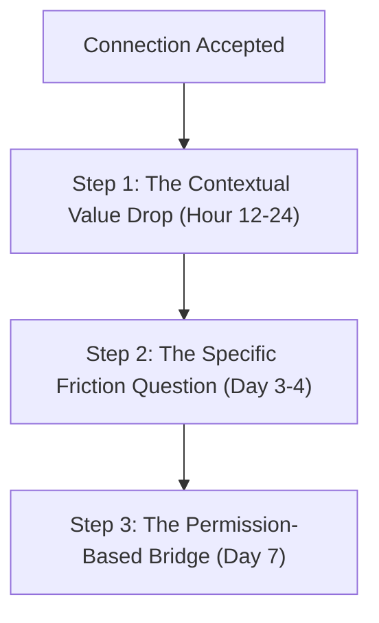

# LinkedIn Inbox Triage & Direct Message (DM) Playbook

A structured playbook for handling connection requests, outbound outreach, and inbound lead conversion with zero spam mechanics and maximum reply rates.

---

## 1. The 200-Character Invite Note

LinkedIn limits connection request notes to **200 characters** for standard users (and truncates longer notes on mobile).
Never pitch. Never ask for a 15-minute call.

### Anatomy of an Elite Invite Note
```
[The Specific Hook] + [Shared Context / Observation] + [Clean Ask]
```

### High-Converting Formulas (≤ 200 Characters)
- **Formula 1 (The Content Bridge):**
  > *"Loved your take on decoupling SQLite writes. Testing WAL mode on our ingestion engine today. Would love to stay connected here!"* (131 chars)
- **Formula 2 (The Product / Ship Notice):**
  > *"Congrats on shipping v2.0 of the routing engine! Followed your team's architecture teardown. Keen to follow your updates."* (122 chars)
- **Formula 3 (The Peer Observation):**
  > *"Building in the data engineering space as well. Your post on pipeline observability hit home. Let's connect!"* (114 chars)
- **Formula 4 (The Mutual Ecosystem):**
  > *"Saw your contribution to the FastMCP ecosystem. Great work on async tool schemas. Hope to connect!"* (99 chars)

---

## 2. The 3-Step Outbound Conversation Ladder

Once a connection request is accepted, **do NOT pitch immediately**. Pitching within 5 minutes of acceptance triggers instant muting.



### Step 1: The Contextual Value Drop (12–24h After Accept)
*Deliver pure value without asking for anything.*
> *"Thanks for connecting, [Name]! Noticed your team recently migrated to multi-region Postgres. We compiled an internal checklist on connection pooling edge-cases last month—figured it might save your team a headache: [Raw Markdown/Snippet]. Hope your week is off to a great start!"*

### Step 2: The Specific Friction Question (Day 3–4)
*Ask a single, low-friction diagnostic question.*
> *"Curious [Name]—when benchmarking your ETL pipeline, what's currently the primary bottleneck: disk I/O, lock contention, or memory serialization? We ran into a bizarre WAL checkpoint issue earlier and curious if that's standard across your scale."*

### Step 3: The Permission-Based Bridge (Day 7)
*Only if they engaged positively in Step 2.*
> *"Makes total sense—we saw that exact lock behavior with 10k concurrent workers. We solved it with an asynchronous token bucket. Happy to send over the 1-page technical memo if you want to take a look, or jump on a quick 10-min screen share. No worries either way!"*

---

## 3. Inbound Inbox Triage (5 Buckets)

Triage your incoming DMs and connection requests every 48 hours into 5 distinct buckets:

| Bucket | Inbound Signal | Action & SLA | Template Response |
| :--- | :--- | :--- | :--- |
| **LEAD** | Mentions a specific business problem, asks about working together, pricing, or consulting. | Reply within 4 hours. Give a direct, helpful technical answer, then offer a low-pressure diagnostic call. | *"Thanks for reaching out! Regarding [specific bottleneck], the fastest fix is usually [X]. If you'd like, I can review your architecture diagram for 15 mins tomorrow: [Calendar Link]."* |
| **PEER** | Fellow developer/founder sharing insights, asking feedback, or discussing common tools. | Reply within 24 hours. Foster genuine relationship. | *"Great observation on [topic]. We actually found that [insight]. Would love to see what you ship next!"* |
| **RECRUITER** | Talent sourcer offering roles or asking about availability. | Canned response within 48h. Keep bridge intact. | *"Thanks for reaching out! Not currently exploring new opportunities as I'm 100% focused on [Current Project], but happy to stay connected."* |
| **SALES PITCH** | Cold automated templates (*"I came across your profile and noticed you are a leader at..."*). | Ignore or send a polite 1-line deflection. | *"Thanks, but we currently have a locked tooling stack for 2026."* |
| **SPAM / BOT** | Crypto promotions, generic WhatsApp redirection, fake accounts. | Delete / Block immediately. | *[Block & Report]* |
