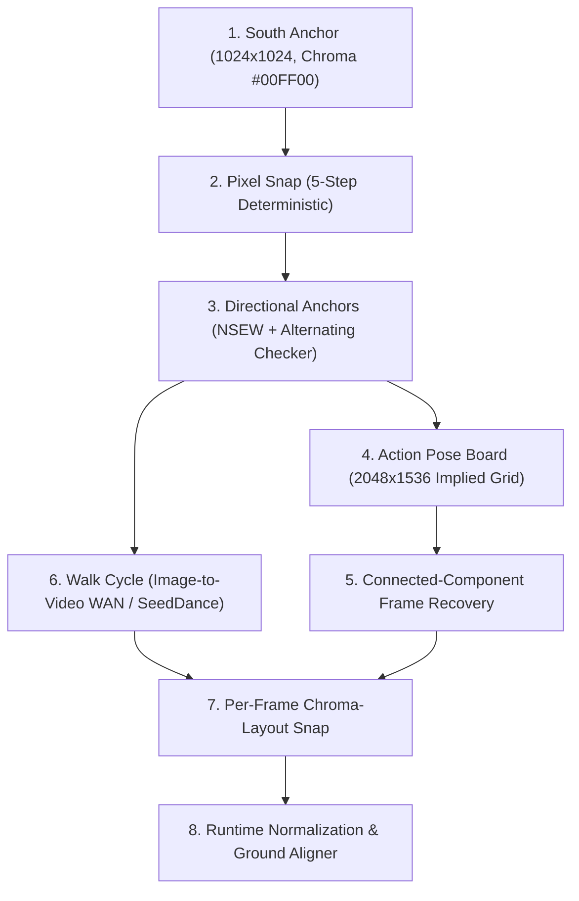

# 2D Pixel-Snapped Game Spritesheet Pipeline

Use this skill when generating 2D pixel-art sprites, character turnaround sheets, or animation cycles (walk, attack, hurt, idle) using Generative AI (Images 2.0, SeedDance 2.0, WAN 2.0, Retro Diffusion, Fal.ai) and deterministic computer vision.

Solves the core failure mode in AI-generated pixel art: **"mixels"** (sub-pixel noise, anti-aliased smearing, inconsistent grid pitch, and jittery walk loops).

---

## 1. Asset Contract & Size Standards

To ensure stylistic consistency across a game world, enforce strict pixel density contracts (derived from Retro Diffusion & Retro del Sol production standards):

| Asset Category | Target Resolution (Native Grid) | Example Assets | Triangle/Pixel Budget |
|---|---|---|---|
| **Items / Pickups** | `16 × 16` px | Coins, potions, keys, gems, small inventory icons | 1-4 color clusters |
| **Props / Foliage** | `32 × 32` px | Barrels, park benches, crates, street lamps, trees | Coarse outlines, 8-16 colors |
| **Characters & Mounts** | `64 × 64` px | Player avatars, NPC couriers, monsters, horses, vehicles | Ground-anchored, 16-32 colors |
| **Buildings / Cottages**| `128 × 128` px | Houses, market stalls, windmills, small gates | Architectural symmetry |
| **Landmarks / Monuments**| `256 × 256` px | Cathedrals, castles, bridges, harbour piers | High-contrast structural silhouettes |

> [!IMPORTANT]
> **Prompt Discipline Lever**:
> Keep prompts short and restrictive. Prompts with excessive detail produce small native grids that the Pixel Snap algorithm cannot cleanly resolve. Prompts with strict silhouette constraints produce chunky, bold pixel clusters that survive every downstream stage.

---

## 2. The 8-Stage Production Pipeline



---

### Stage 1: South Anchor Generation
The south-facing candidate is the single source of truth from which all directional anchors and animation frames derive.

- **Canvas**: `1024 × 1024` PNG.
- **Background**: Solid chroma key (`#00FF00` pure green, `#FF00FF` magenta, or `#0000FF` blue). Never gradient or transparent background during generation.
- **Prompt Structure**:
  ```text
  [Subject], South-facing front view, retro 16-bit pixel art character sprite. Full body visible from head to boots. Centered on solid bright green (#00FF00) background. Chunky pixels, sharp clean edges, flat cel shading, limited color palette, no anti-aliasing, no drop shadow, no gradients, no mixels.
  ```

---

### Stage 2: The Deterministic Pixel Snap Algorithm
Pixel snap is **not an AI model** — it is a pure mathematical image-processing algorithm (ported from Sprite Fusion `spritefusion-pixel-snapper`). It eradicates mixels by recovering the latent grid and voting colors:

1. **Palette Quantization**: Run K-means clustering ($k=256$ or target game palette) in CIELAB color space.
2. **Edge-Gradient Profiling**: Compute horizontal and vertical Sobel gradient profiles:
   $$\nabla_x = |I * G_x|, \quad \nabla_y = |I * G_y|$$
3. **Pitch Recovery**: Compute autocorrelation of 1D gradient projections to extract the median pixel cell pitch $P$ (typically 16px, 24px, or 32px within the 1024px canvas).
4. **Grid Cut-Walking**: Align a regular orthogonal lattice to the gradient peaks across the $X$ and $Y$ axes.
5. **Majority-Color Resampling**: In each grid cell $C_{i,j}$, replace all internal pixels with the mode color:
   $$\text{Color}(C_{i,j}) = \text{mode}\{c \in C_{i,j}\}$$

```python
# pixel_snap_core.py
import numpy as np
from PIL import Image
from scipy.signal import find_peaks

def compute_cell_pitch(gradient_1d: np.ndarray, min_distance: int = 8) -> int:
    """Finds the median spacing between sharp pixel edge peaks."""
    peaks, _ = find_peaks(gradient_1d, distance=min_distance, prominence=np.max(gradient_1d) * 0.2)
    diffs = np.diff(peaks)
    return int(np.median(diffs)) if len(diffs) > 0 else 16
```

---

### Stage 3: Directional Anchors (NSEW)
Generate West and North anchors conditioned on the snapped South anchor. **East is always a horizontal flip of West** (`Image.FLIP_LEFT_RIGHT`) to preserve pixel symmetry.

- **Dual-Image Input conditioning**:
  1. `Snapped Chroma South Anchor` (Identity reference).
  2. `Alternating-Pixel Guide Checker` (`1024 × 1024` black/white 1px checkerboard). This forces the vision diffusion model to adhere to the exact native grid pitch.
- **Directions**:
  - `South (0°)`: Base anchor.
  - `West (270°)`: Profile walking pose.
  - `North (180°)`: Back view, showing cloak/quiver/hair silhouette.
  - `East (90°)`: `flip_horizontal(West)`.

---

### Stage 4: Action Pose Boards (Idle, Attack, Hurt, Jump, Death)
Generate a multi-frame pose board (`2048 × 1536` PNG) containing 4 to 8 animation keyframes on a loose layout.

- **Why pose boards dynamic overshoot**: In combat moves (greatsword swing, leap, recoil), limbs and weapons swing outside rigid cell borders.
- **Input Conditioning**: Snapped directional anchor + 4×3 alternating-pixel pose board guide.

---

### Stage 5: Connected-Component Frame Recovery (Never Naive Grid Slicing!)

> [!CAUTION]
> **Never use naive uniform grid slicing (e.g. slicing 512x512 tiles).**
> Naive grid cropping will decapitate swinging weapons, follow-through capes, or stretched limbs that cross the cell threshold.

#### The Recovery Algorithm
1. Mask out chroma background (`#00FF00` within tolerance $\Delta E < 10$).
2. Morphological dilation ($3 \times 3$ kernel) to bridge weapon handles and floating spell particles to the main body.
3. Label connected components via `scipy.ndimage.label`.
4. Filter out noise components ($\text{area} < 64$ pixels).
5. Extract bounding boxes $[x_{\min}, y_{\min}, x_{\max}, y_{\max}]$, sorting left-to-right, top-to-bottom.

```python
# frame_recovery.py
import numpy as np
from scipy.ndimage import label, find_objects

def recover_foreground_frames(rgba_image: np.ndarray) -> list[tuple[int, int, int, int]]:
    alpha = rgba_image[:, :, 3] > 0
    labeled, num_features = label(alpha)
    slices = find_objects(labeled)
    valid_boxes = []
    for s in slices:
        h = s[0].stop - s[0].start
        w = s[1].stop - s[1].start
        if w > 32 and h > 32:  # Filter dust/noise
            valid_boxes.append((s[1].start, s[0].start, s[1].stop, s[0].stop))
    # Sort primarily by row, then by column
    return sorted(valid_boxes, key=lambda b: (b[1] // 300, b[0]))
```

---

### Stage 6: Walk Cycles via Image-to-Video (I2V)
Still-image models consistently fail at walking cycles (feet slide, proportions warp, heads wobble).
- **Solution**: Use Image-to-Video models (SeedDance 2.0 or WAN 2.0 via Fal.ai).
- Feed the snapped West anchor as frame 0 with prompt: `"Character walking in place, side profile, constant ground contact, steady cadence, seamless loop"`.
- Sample 8 to 12 frames at equal intervals across the walk cycle.

---

### Stage 7: Per-Frame Chroma-Layout Snap
Every recovered frame from Stage 5 or Stage 6 must undergo an **individual Pixel Snap pass**. Snapping the full multi-frame board in one pass creates bleed artifacts across cell borders. Snapping each isolated frame guarantees sharp boundaries.

---

### Stage 8: Runtime Normalization & Ground Aligner
1. **Chroma Despeckle**: Remove single-pixel green fringes around the perimeter.
2. **Ground-Truth Contact Alignment**:
   - Locate the lowest non-transparent pixel in each frame ($Y_{\text{contact}}$).
   - Anchor all frames so their contact point aligns to $Y = \text{FrameHeight} - 16\text{px}$.
3. **Export Sheets**:
   - Pack into uniform power-of-two spritesheets (`1024 × 512`, `1280 × 512`, or `2048 × 2048`).
   - Export JSON metadata with frame coordinates and frame rates (e.g. 10 FPS for walk, 15 FPS for attack).

---

## 3. Anti-Patterns to Avoid

❌ **Anti-pattern: Generating transparent PNGs directly from diffusion models.**
- *Why bad*: Diffusion models produce semi-transparent anti-aliased alpha halos that break 16-bit retro aesthetics.
- *Fix*: Always generate against solid high-contrast chroma key (`#00FF00`), then strip in post-processing.

❌ **Anti-pattern: Using 128x128 for simple props and 32x32 for characters.**
- *Why bad*: Inconsistent texel density makes characters look like giant low-res blocks next to ultra-detailed props.
- *Fix*: Strictly adhere to the Size Contract (Section 1).

❌ **Anti-pattern: Attempting to generate East and West frames separately.**
- *Why bad*: AI cannot maintain exact armor details, scars, or weapon designs when asked to flip facing direction.
- *Fix*: Generate West only, then programmatically mirror to East (`ImageOps.mirror`).
