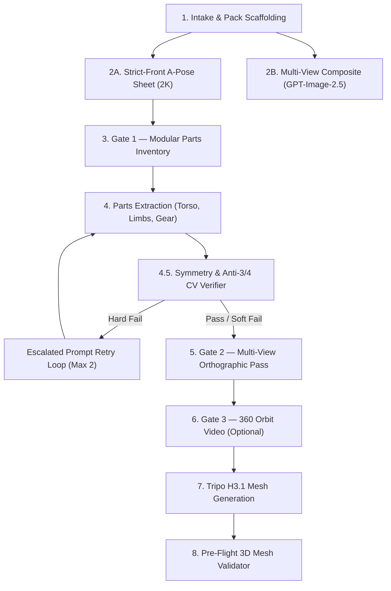

# 🎨 3D Character Sheet Pipeline & Asset Routing (SOTA 2026)

> **Inspirations & Provenance :** Stefan Vaskevich (*Stefan 3D AI*, top3d.ai), World of Oldcraft 36h Autonomous MMO Build Kit, Overlord 3D Engine Production Pipeline.  
> **Cardinal Rule :** **STRICT FRONT, NEVER 3/4.** Every body part, paired item, and accessory must be generated at dead-front camera angle matching the strict front A-pose orientation.

---

## 🎯 Purpose & The Hardest 3D Problem

In generative image-to-3D pipelines (Tripo H3.1, Rodin, Hunyuan, Pixal3D), multi-part meshes (torso, armor plates, limbs, boots, weapons, hairstyles) **cannot be reassembled if generated at 3/4 hero angles**. 
- Seams misalign.
- Clothing clips through anatomy.
- Headwear floats or pierces skulls.
- Skeletons cannot be universally fitted across race variants.

This skill solves this bottleneck by turning 1 initial concept art into an assemblable, orthographically aligned reference package with automated vision-classifier verification to eliminate 3/4 drift before downstream modeling.

---

## 📦 Output Reference Package Architecture

```
character_pack/
  ├── 00_sheet/
  │   ├── 01a_apose_front.png         # Strict front, white bg, flat light, 2K (Nano Banana Pro)
  │   ├── 01b_character_sheet.png     # 16:9, 3 projections (front/side/back) + accessories laid out (GPT-Image-2.5)
  │   └── parts_inventory.md          # Numbered catalog of detected modular parts
  ├── 01_parts/
  │   ├── body_torso_front.png        # Strict front, in-pose, white bg, 2K
  │   ├── body_legs_front.png         # Strict front, in-pose
  │   ├── body_arms_front.png         # Strict front, in-pose
  │   ├── head_front.png              # Neutral front, no expression
  │   ├── hair_front.png              # Isolated, front-facing, soft alpha
  │   ├── hands_pair_front.png        # Close-crop, palms-to-camera, dead front
  │   ├── boots_pair_front.png        # Close-crop, dead front
  │   └── [accessory_name]_front.png  # One per accessory (hat, weapon, shield, pauldron)
  ├── 02_multiview/                   # Generated for approved parts (Gate 2)
  │   ├── body_torso_side.png
  │   ├── body_torso_back.png
  │   ├── head_side.png
  │   └── head_back.png
  ├── 03_360/                         # Optional 360 orbit MP4s (Gate 3, Seedance 2.0 locked-orbit)
  │   ├── full_character_360.mp4
  │   └── [part_name]_360.mp4
  ├── 04_mesh_raw/                    # Tripo H3.1 / P1 generated GLB/FBX meshes
  └── manifest.json                   # Parts list, models used, seeds, classifier scores, token costs
```

---

## 🔄 The 8-Stage Pipeline with Deterministic WAT Tooling



---

### Stage 1: Intake & Pack Scaffolding
- **Input**: 1 character image (any pose, any lighting, any style).
- **Brief**: Target art style (e.g., stylized fantasy, chunky silhouette, hand-painted albedo, no specular highlights), mandatory accessories, and forbidden elements.
- **Scaffold Package**: Run `scaffold_character_pack.py` to create the standard folder hierarchy and initialize `manifest.json`.

```bash
uv run scripts/scaffold_character_pack.py -d character_pack/ -n paladin_warrior -s stylized_pbr --accessories greatsword shield pauldrons
```

---

### Stage 2A: Strict-Front A-Pose Sheet (The Workhorse)
- **Goal**: ONE clean full-body character sheet in A-pose at **dead-front camera angle (NOT 3/4)** on pure white/neutral-grey backdrop, flat lighting, no dramatic perspective distortion.
- **Resolution**: 2K (2048×2048).
- **Model Priority**: `Nano Banana Pro` (Primary) -> `Nano Banana 2` (Fallback). Never use GPT-Image-2.5 here.
- **Prompt Reference**: See [`prompts/01a_apose_front.md`](prompts/01a_apose_front.md).

---

### Stage 2B: Supplementary Multi-View Sheet (Visual Aid)
- **Goal**: ONE 16:9 composite sheet showing FRONT, SIDE, and BACK orthographic projections, plus accessories laid out neatly to the side.
- **Model Priority**: `GPT-Image-2.5` (`openai/gpt-image-2.5/flare/*`).
- **Prompt Reference**: See [`prompts/01b_character_sheet.md`](prompts/01b_character_sheet.md).

---

### Stage 3: Gate 1 — Confirm Modular Parts List
Categorize all detected components in `character_pack/parts_inventory.md`:
1. `body-essential`: Torso, legs, arms, head. Must be strict front A-pose so assembly seams align.
2. `paired`: Hands/gloves, boots/feet. Close-crop pair preserving identical strict-front orientation.
3. `accessory`: Hat, weapon, shield, shoulder pauldrons, backpack, cloak. Front-facing default.
4. `hair`: Isolated front view with soft alpha edges.

---

### Stage 4: Parts Extraction (Strict Front)
Generate each approved part at 2K resolution matching orientation, scale, and lighting of Stage 2A:
- **Torso/Limbs**: [`prompts/02_parts_body.md`](prompts/02_parts_body.md)
- **Hands/Boots**: [`prompts/03_parts_paired.md`](prompts/03_parts_paired.md)
- **Accessories**: [`prompts/04_parts_accessory.md`](prompts/04_parts_accessory.md)
- **Hair**: [`prompts/05_parts_hair.md`](prompts/05_parts_hair.md)

---

### Stage 4.5: Automated Computer Vision Symmetry & Anti-3/4 Verifier
Run `verify_orthographic_symmetry.py` immediately on every generation to eliminate 3/4 drift and spinal tilt without relying solely on expensive multimodal LLM calls.

```bash
uv run scripts/verify_orthographic_symmetry.py -i character_pack/00_sheet/01a_apose_front.png --category body-essential --min-symmetry 0.80
```

#### Metrics Checked:
- **Bilateral Symmetry (Dice / IoU)**: Computes horizontal silhouette reflection overlap.
- **Spine Tilt**: Detects contrapposto body lean ($\theta_{\text{tilt}} \le 4^\circ$).
- **Estimated Azimuth Drift**: Detects 3/4 camera angle ($|\theta_{\text{azimuth}}| \le 9^\circ$).
- **Boundary Crop**: Ensures geometry is not clipped at image borders.

#### Bounded Retry Loop:
If the verifier outputs `HARD_FAIL`, use the generated `escalated_correction_prompt` (prepending the exact estimated rotation degrees) and retry (max 2 retries):
- *Retry 1*: Primary model with escalated prompt.
- *Retry 2*: Secondary model (`Nano Banana 2`) with escalated prompt.
- *Prompt Rubric*: See [`prompts/08_3q_classifier.md`](prompts/08_3q_classifier.md).

---

### Stage 5: Gate 2 — Multi-View Orthographic Pass
- Propose side and back views for approved body-essential parts and hair.
- Reference: [`prompts/06_multiview.md`](prompts/06_multiview.md).

---

### Stage 6: Gate 3 — 360 Turntable Video (Optional)
- Locked-camera orbit video (4-6s) using `Seedance 2.0` or `Kling`.
- Reference: [`prompts/07_360_video.md`](prompts/07_360_video.md).

---

### Stage 7: Downstream 3D Mesh Generation & Routing

| Asset Type | Recommended 3D Engine | Parameters | Notes |
|---|---|---|---|
| **Hero Humanoid & Creatures** | `Higgsfield tripo_h3_1_image_to_3d` or `tripo_h3_1_multiview_to_3d` | `geometry_quality: detailed`, `texture_quality: detailed`, `texture_alignment: original_image` | Produces clean GLB with 4K base color + ORM + normal. Decimate to 10k-20k tris in Blender. |
| **Modular Props & Environment** | `tripo3d/p1/image-to-3d` | `texture: true`, `face_limit: 8000` | Ideal for carts, barrels, lamps, fences, weapons. |
| **Tiling PBR Terrain & Surfaces** | `fal-ai/patina/material` | `maps: [basecolor, normal, roughness, metalness, height]`, `tiling_mode: both`, `enable_prompt_expansion: false` | Generates seamless PBR texture sets from text prompt or blurred reference. |

---

### Stage 8: Pre-Flight 3D Mesh & Texture Validation
Before rigging in Blender or importing into Unreal Engine 5 / Unity, validate the raw `.glb` mesh with `validate_3d_character_mesh.py`:

```bash
uv run scripts/validate_3d_character_mesh.py -i character_pack/04_mesh_raw/character.glb --max-tris 45000
```

- **Checks**:
  - Triangle budget ($< 45,000$ tris for hero, $< 10,000$ for props).
  - Ground pivot alignment ($Z=0$ or $Y=0$ floor coordinate).
  - PBR textures (BaseColor, Normal, Metallic-Roughness).

---

## 📚 References & Playbooks

- [Orthographic 3D Reference Playbook](references/orthographic_pipeline_playbook.md): Strict A-pose joint angles, modular seam alignment planes, and engine routing matrices.
- [`blender-game-rigging-animation`](../blender-game-rigging-animation/SKILL.md): Ingests GLB meshes, re-centers pivots, binds Mixamo skeleton, and bakes animations.
- [`mixamo-animation-library-engine`](../mixamo-animation-library-engine/SKILL.md): Supplies 90+ standard humanoid animation clips to drive the character.
