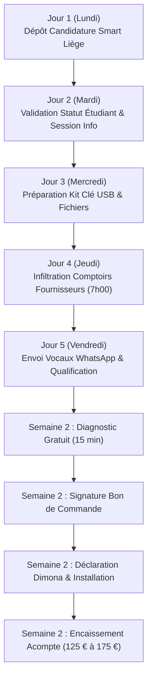

# PLAN D'ACTION OPÉRATIONNEL JOUR PAR JOUR (SEMAINE 1 & 2)
## Guide Pas-à-Pas pour Brandon : Du Dépôt Smart au Premier Client Encaissé

---

### VUE D'ENSEMBLE DU CALENDRIER DE LANCEMENT



---

### SEMAINE 1 : SÉCURISATION ADMINISTRATIVE & PROSPECTION

#### JOUR 1 (LUNDI) — DÉPÔT FORMEL CHEZ SMART LIÈGE
- [ ] **Matin (9h00 - 10h30) :**
  1. Se connecter sur [smart.coop/fr/agenda](https://smart.coop/fr/agenda) et s'inscrire à la prochaine session d'information générale de Smart Liège (Blvd d'Avroy).
  2. Se connecter sur le portail [studentatwork.be](https://www.studentatwork.be) via Itsme et télécharger l'attestation PDF du contingent des 600 heures.
  3. Récupérer l'attestation officielle d'inscription de l'établissement de promotion sociale (mentionnant le nombre d'heures / crédits hebdomadaires).
- [ ] **Après-midi (14h00 - 15h00) :**
  1. Ouvrir le fichier `DOSSIER_CANDIDATURE_SMART_LIEGE.md`.
  2. Compléter son nom, NISS, adresse et téléphone.
  3. Envoyer l'email officiel à `liege@smart.coop` avec les 4 pièces jointes :
     - Lettre de cadrage signée
     - Attestation Student@work ONSS
     - Attestation d'inscription promotion sociale
     - Carte d'identité recto-verso
- [ ] **Résultat attendu :** Accusé de réception de Smart Liège et fixation du rendez-vous d'accueil.

---

#### JOUR 2 (MARDI) — PRÉPARATION DES OUTILS & LOGISTIQUE
- [ ] **Matin (10h00 - 12h00) :**
  1. Vérifier que Python 3.12 et openpyxl sont bien opérationnels sur son PC portable.
  2. Lancer la suite de tests automatisés :
     ```powershell
     python test_btp_suite.py
     ```
     *(Tous les tests doivent afficher `OK` en vert).*
  3. Copier sur une clé USB dédiée (ou dossier OneDrive synchronisé) :
     - `DEVIS_SANS_OUBLI_MODELE_PRO.xlsx`
     - `FICHIER_PROSPECTION_LIEGE_BTP.xlsx`
     - `PACK_BIENVENUE_ET_FORMATION_CLIENT.md`
     - `BON_DE_COMMANDE_PROPOSITION_COMMERCIALE.md`
- [ ] **Après-midi (14h00 - 16h00) :**
  1. Tester l'outil Quick Assist (Assistance Rapide Windows) avec un ami ou un second PC :
     - Appuyer sur `Touche Windows + Ctrl + Q`.
     - Générer un code de partage et tester la prise de main à distance en 60 secondes.
  2. Imprimer 5 exemplaires du `BON_DE_COMMANDE_PROPOSITION_COMMERCIALE.md` et de la plaquette synthétique d'une page (Flyer).

---

#### JOUR 3 (MERCREDI) — QUALIFICATION DES 5 PROSPECTS LIÉGEOIS
- [ ] **Matin (9h00 - 11h30) :**
  1. Ouvrir le fichier `FICHIER_PROSPECTION_LIEGE_BTP.xlsx`.
  2. Vérifier les coordonnées des 5 premiers prospects ciblés :
     - Alain Renard (*Chauffage Meuse Confort*, Angleur)
     - Benoît Lambert (*Électricité Lambert & Fils*, Chaudfontaine)
     - Fabrice Martin (*Verviers Sanitaire Sprl*, Verviers)
     - Thierry Dumont (*Rénov Mosane*, Seraing)
     - Guy Collard (*Clim & Chauffage Herstal*, Herstal)
  3. Vérifier sur Google Maps et sur la Banque-Carrefour des Entreprises (BCE) que leurs numéros de téléphone et adresses d'ateliers sont bien à jour.
- [ ] **Après-midi (14h00 - 16h30) :**
  1. Préparer les 5 messages vocaux personnalisés selon le script du `KIT_PROSPECTION_VENTE.md`.
  2. Répéter le script à haute voix (ton posé, direct, zéro jargon commercial agressif).

---

#### JOUR 4 (JEUDI) — GUÉRILLA TERRAIN : COMPTOIRS FOURNISSEURS (7H00)
- [ ] **Tôt le matin (6h45 - 8h15) :**
  1. Se rendre au comptoir d'un grand fournisseur professionnel liégeois :
     - Exemples : Facq Liège (Rue d'Abhooz ou Coronmeuse), Rexel Liège, ou Saint-Gobain Distribution.
  2. Boire un café au comptoir. C'est l'heure où les patrons de TPE et chefs d'équipe viennent charger les camionnettes avant le chantier de 8h00.
  3. Engager la conversation simplement :
     > *« Salut ! Vous tournez à combien de camionnettes sur Liège ? ... C'est la folie en ce moment avec les demandes de devis de chaudières/pompes à chaleur ? Vous arrivez à tout relancer le soir ? »*
  4. Laisser la carte de visite / flyer d'une page avec le QR code ou numéro direct.
- [ ] **Après-midi (14h00 - 17h00) :**
  1. Noter les noms et numéros récoltés dans le fichier Excel `FICHIER_PROSPECTION_LIEGE_BTP.xlsx`.
  2. Envoyer le premier message WhatsApp ou email de suivi aux artisans rencontrés.

---

#### JOUR 5 (VENDREDI) — VENDREDI 16H30 : LE TEST EN DIRECT
- [ ] **Fin d'après-midi (16h00 - 17h30) :**
  1. Appeler par téléphone les 3 prospects les plus chauds.
  2. C'est le moment exact où ils rentrent de chantier, fatigués, avec la perspective de passer leur week-end sur des devis :
     > *« Bonjour Alain, c'est Brandon. C'est juste pour savoir : ce week-end, vous avez combien de devis qui traînent sur votre bureau ? Si vous me donnez 15 minutes mardi matin à 7h à votre atelier, je vous montre comment ne plus jamais perdre un devis sans changer vos habitudes. »*
  3. Verrouiller 2 rendez-vous de démonstration pour le début de semaine 2.

---

### SEMAINE 2 : TRANSFORMATION, CONTRAT & INSTALLATION

#### JOUR 6 (MARDI SEMAINE 2) — LE DIAGNOSTIC TERRAIN (15 MIN CHRONO)
- [ ] **Arrivée chez l'artisan (7h15 ou 17h30) :**
  1. Ouvrir son PC portable avec `DEVIS_SANS_OUBLI_MODELE_PRO.xlsx` prêt à l'emploi.
  2. Demander au patron : *« Donnez-moi juste les 3 derniers devis que vous avez envoyés le mois dernier. »*
  3. Les saisir sous ses yeux dans le tableau : voir la colonne rouge "À RELANCER D'URGENCE" s'afficher.
  4. Appliquer le script de closing en 3 questions (`GUIDE_OBJECTIONS_ET_CLOSING_BTP.md`).
  5. Faire signer le `BON_DE_COMMANDE_PROPOSITION_COMMERCIALE.md` (Pack 1 à 250 € ou Pack 2 à 350 € HTVA).
  6. Récupérer l'acompte de 50 % (par virement bancaire sur le compte Smart Coop).

---

#### JOUR 7 (MERCREDI SEMAINE 2) — DÉCLARATION SMART & DÉPLOIEMENT
- [ ] **Matin : Déclaration légale préalable (Dimona) :**
  1. Se connecter sur le portail en ligne Smart Coop.
  2. Créer le contrat de mission avec les données du client (N° TVA, nom de l'entreprise).
  3. Fixer la date de prestation et encoder la déclaration **avant minuit la veille de l'intervention**.
- [ ] **Après-midi : Installation technique (1h30 à 2h00) :**
  1. Se connecter à distance via Quick Assist ou passer à l'atelier de l'artisan.
  2. Installer le fichier Excel sur son bureau PC et créer la sauvegarde OneDrive / Google Drive.
  3. Installer le raccourci mobile PWA sur son smartphone (procédure du `PACK_BIENVENUE_ET_FORMATION_CLIENT.md`).
  4. Former l'artisan ou son assistante pendant 30 minutes.

---

#### JOUR 8 (JEUDI SEMAINE 2) — CLÔTURE & ENCAISSEMENT DU SOLDE
- [ ] **Validation finale :**
  1. Faire tester une saisie réelle par l'artisan lui-même sur son smartphone.
  2. Faire valider la réception du bon de livraison / PV de recette.
  3. Émettre la facture finale de solde de 50 % via l'outil de facturation Smart.
  4. Envoyer le premier "Rapport Patron" de test généré par `generate_rapport_patron.py`.
- [ ] **Proposer le relais d'abonnement récurrent :**
  - Proposer le Pack 3 à 180 € HTVA / trimestre (60 €/mois) pour le suivi des sauvegardes et le rapport mensuel automatique.

---

### RÈGLES DE SURVIE POUR NE JAMAIS S'ÉPARPILLER

1. **Ne jamais baisser le prix sous 250 € HTVA :** En dessous, le budget Smart ne couvre pas le coût salarial journalier minimum légal de la CP 200.
2. **Ne jamais accepter de cash non déclaré :** Utiliser le script de refus élégant (`GUIDE_TERRAIN_FISCAL_ET_VENTE.md`).
3. **Toujours déclarer la prestation sur le portail Smart AVANT de travailler :** L'ONSS interdit strictement les déclarations rétroactives.
4. **Rester focalisé sur la région liégeoise au démarrage :** Densité d'artisans maximale, déplacements courts, bouche-à-oreille rapide entre confrères du bâtiment.
