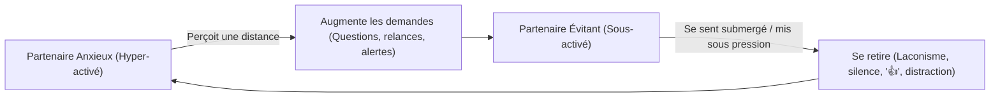

# Matrice Clinique : Attachement, Mentalisation & Modèle de Gottman

Ce document constitue la référence théorique et clinique avancée du skill `conversational-dynamics-profiler`. Il formalise les grilles de lecture psychologiques appliquées à l'analyse des conversations textuelles asynchrones.

---

## 1. Les Quatre Cavaliers de Gottman appliqués à l'Écrit

Dans la méthode de John Gottman, la présence de ces quatre patterns prédit la détérioration relationnelle avec une précision supérieure à 90 %. En messagerie instantanée, ils prennent des formes spécifiques :

| Cavalier | Manifestation Textuelle | Risque Relationnel | Antidote Opérationnel |
|---|---|---|---|
| **Critique (Criticism)** | Attaque globale de l'identité plutôt qu'une plainte sur un fait précis (*« Tu es toujours à deux vitesses »*, *« Tu ne penses jamais à… »*). | Active la défense immédiate de l'autre. | **Démarrage en douceur (Gentle Start-up)** : Parler de son propre ressenti sans accuser (*« Je me sens insécure quand je reçois un mot court, j'ai besoin d'un signe plus clair »*). |
| **Mépris (Contempt)** | Moquerie condescendante, cynisme, sarcasme mordant, émojis de dédain (`🙄`, `😒`), insultes déguisées en vannes. | Le destructeur n°1 du lien (corrosif pour l'estime et la santé). | **Culture d'appréciation** : Exprimer régulièrement de la gratitude et valoriser les efforts observables. |
| **Défense (Defensiveness)** | Se poser en victime, contre-attaquer, trouver des excuses techniques (*« C'est pas ma faute, j'étais occupé »*, *« Tu fais pareil »*). | Empêche la réparation et fait escalader le conflit. | **Prise de responsabilité partielle** : Valider immédiatement la part légitime du malaise (*« Tu as raison, mon message était sec, désolé »*). |
| **Dérobade (Stonewalling)** | Retrait brutal, silence radio sans explication, non-réponse prolongée (Ghosting temporaire), monosyllabes (*« K »*, *« 👍 »*). | Déclenche la panique chez l'anxieux ou la rupture chez l'évitant. | **Pause annoncée (Self-soothing)** : Nommer l'indisponibilité avant de couper (*« J'ai besoin de 2h de calme, je te réponds posément ce soir »*). |

> **Le Ratio 5:1 de Gottman :** Dans une relation stable, il doit y avoir au moins 5 interactions positives (validation, rire partagé, mot doux, soin, curiosité) pour chaque interaction négative (critique, friction, malentendu).

---

## 2. Théorie de la Mentalisation (Peter Fonagy)

La mentalisation est la capacité à interpréter son propre comportement et celui d'autrui comme étant motivé par des états mentaux internes (désirs, sentiments, croyances).

```text
 ┌─────────────────────────────────────────────────────────────────┐
 │                   ÉCHELLE DE MENTALISATION                      │
 ├─────────────────────────────────────────────────────────────────┤
 │  [Niveau 3] Mentalisation Riche & Flexible                      │
 │  ↳ Reconnaissance que l'autre a son propre monde intérieur      │
 │  ↳ Curiosité authentique : "Qu'as-tu ressenti quand j'ai dit ça ?"│
 ├─────────────────────────────────────────────────────────────────┤
 │  [Niveau 2] Mode Téléologique (Preuve par l'acte)              │
 │  ↳ Seuls les actes physiques observables comptent comme preuve. │
 │  ↳ "Si tu m'aimes, dis-le à voix haute / viens me voir."        │
 ├─────────────────────────────────────────────────────────────────┤
 │  [Niveau 1] Mode Équivalence Psychique                          │
 │  ↳ Ce qui est ressenti intérieurement EST la réalité objective. │
 │  ↳ "Je ressens de la froideur, donc tu es froid / tu me rejettes"│
 ├─────────────────────────────────────────────────────────────────┤
 │  [Niveau 0] Mode Semblant (Pretend Mode / Intellectualisation)   │
 │  ↳ Mots déconnectés de l'affect ; hyper-rationalisation ou      │
 │  ↳ Vannes potaches systématiques pour éviter l'intimité brute.  │
 └─────────────────────────────────────────────────────────────────┘
```

### Diagnostics des dérives :
- **Basculement Téléologique** : Quand un partenaire exige des preuves matérielles constantes (cadeaux, dates précises, voix au lieu du texte) pour croire à l'amour.
- **Piège de l'Équivalence Psychique** : Quand un délai de réponse de 30 minutes est automatiquement interprété comme un désintérêt amoureux.
- **Évitement par le Mode Semblant** : Quand l'un des partenaires désamorce chaque émotion sérieuse par une blague sexuelle ou un mème, empêchant la connexion émotionnelle réelle.

---

## 3. Dynamique Systémique : Le Cycle Demande-Retrait (Demand-Withdraw)

La danse la plus fréquente dans les relations amoureuses asymétriques :



### Comment briser le cycle :
1. **L'évitant doit faire un pas en avant** : Prévenir au lieu de fuir, valider l'émotion de l'autre en premier.
2. **L'anxieux doit faire un pas en arrière** : Réduire le volume d'appels à la réassurance et accepter que le silence temporaire n'est pas un abandon.
