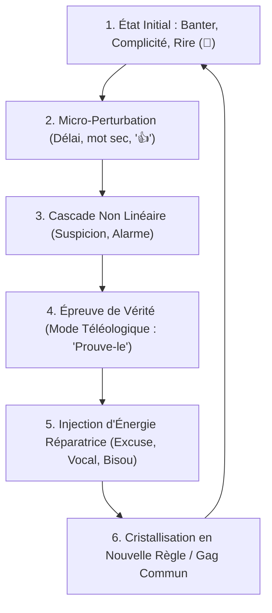

# Neurobiologie de l'Attachement, Théorie Polyvagale & Chaos Relationnel

Ce document constitue la référence clinique et neurobiologique de pointe pour le skill `conversational-dynamics-profiler`. Il décrit la **physiologie du système nerveux autonome sous messagerie asynchrone** et modélise le couple comme un **système dynamique non linéaire dissipatif**.

---

## 1. La Neurobiologie des Échanges Asynchrones : Dopamine vs Ocytocine

Le cerveau humain n'a pas évolué pour communiquer par texte interposé. En messagerie instantanée, deux circuits neurochimiques entrent en concurrence directe :

```text
 ┌─────────────────────────────────────────────────────────────────┐
 │               CIRCUIT 1 : LA BOUCLE DOPAMINE-CORTISOL           │
 │               (Dominante en messagerie écrite / 390 msgs/j)     │
 ├─────────────────────────────────────────────────────────────────┤
 │ 1. Notification / Vibreur ➔ Décharge dopaminergique intermittente│
 │ 2. Attente de réponse (RTT court) ➔ Pic de vigilance/noradrénaline│
 │ 3. Si retard imprévu ➔ Sécrétion de cortisol (insécurité/alerte) │
 │ ↳ Résultat : Hyper-arousal sympathique, marathons nocturnes,    │
 │   besoin addictif de relance permanente pour apaiser la tension.│
 └─────────────────────────────────────────────────────────────────┘
                                 ▲
                                 │ Décalage
                                 ▼
 ┌─────────────────────────────────────────────────────────────────┐
 │               CIRCUIT 2 : LA BOUCLE OCYTOCINE-PARASYMPATHIQUE    │
 │               (Activée par la Voix, le Regard & le Contact)     │
 ├─────────────────────────────────────────────────────────────────┤
 │ 1. Prosodie vocale (timbre, inflexions, soupirs, rires réels)   │
 │ 2. Contact sensoriel (toucher, nourriture partagée, baisers)    │
 │ 3. Sécrétion d'ocytocine & endorphines ➔ Sécurité ventro-vagale │
 │ ↳ Résultat : Baisse instantanée du cortisol, sensation de paix   │
 │   ("ataraxie"), ancrage profond et arrêt des tests d'insécurité.│
 └─────────────────────────────────────────────────────────────────┘
```

> **Le Paradoxe Fondateur :**  
> Plus un couple échange de textos à haute fréquence (390 msgs/j), plus il stimule le circuit dopaminergique excitateur, et plus il a besoin de **preuves vocales ou réelles** pour déclencher le repos vagal. Le texte excite l'attachement ; la voix l'apaise.

---

## 2. La Théorie Polyvagale de Stephen Porges appliquée au Chat

Le système nerveux autonome oscille entre trois états physiologiques :

| État Polyvagal | Comportement en Ligne | Impact sur la Relation | Protocole d'Apaisement |
|---|---|---|---|
| **Ventral Vagal (Sécurité & Engagement)** | Textes fluides, curiosité, vannes partagées, écoute patiente, surnoms doux. | Co-régulation émotionnelle mutuelle. | Continuer la présence détendue. |
| **Sympathique (Mobilisation / Fuite ou Lutte)** | Rafales de messages, majuscules, questions pressantes, reproches (*« Tu es à deux vitesses »*). | Escalade anxieuse ou confrontation. | **Ralentir le tempo**, envoyer un vocal posé, valider l'affect. |
| **Dorsal Vagal (Immobilisation / Shutdown)** | Arrêt brutal des messages, non-réponse prolongée (> 24 h), suppression de contacts. | Déconnexion protectrice par anesthésie. | **Zéro pression**, laisser 12-24h, envoyer une offrande douce (Protocole Alpha). |

---

## 3. Théorie du Chaos : L'Attracteur Étrange du Couple

Un couple n'est pas une ligne droite : c'est un **système dynamique non linéaire** gouverné par un **attracteur étrange** (un cycle récurrent à trajectoires déterministes mais imprévisibles au jour le jour) :



### La Sensibilité aux Conditions Initiales (L'Effet Papillon) :
Dans ce système, une variation infinitésimale de l'entrée peut produire des sorties divergentes :
- Répondre *« 👍 »* à une confidence ➔ Cascade vers l'état 3 (crise de présence).
- Répondre *« Merci mon chaton ❤️ »* à la même confidence ➔ Stabilisation immédiate à l'état 0.
- **Règle d'or de stabilité chaotique :** Réduire la variance de l'entrée en supprimant les réponses ambiguës.
