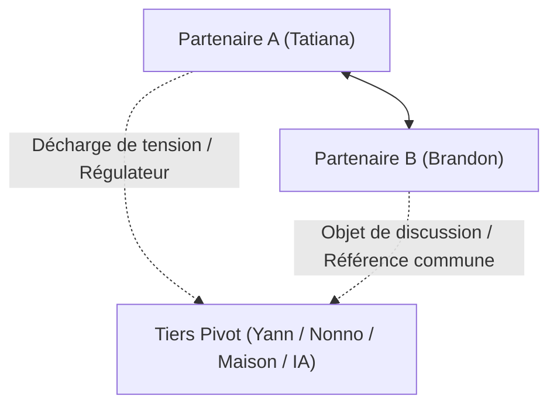

# Sociogramme, Triangulation & Architecture des Frontières

Ce document constitue la référence avancée pour l'analyse des **systèmes relationnels élargis, des dynamiques de tiers et des frontières du couple** (inspiré de la théorie des systèmes familiaux de Murray Bowen et de l'analyse transactionnelle).

---

## 1. La Triangulation selon Murray Bowen

Dans un système dyadique (deux personnes), la tension émotionnelle entre deux partenaires devient instable lorsqu'elle dépasse un certain seuil. Le système recourt alors automatiquement à un **tiers (personne, objet, projet ou technologie)** pour décharger la tension :



### Typologie des Tiers dans les Conversations Privées :
1. **Le Tiers Tampon (Le « Pivot » amical/commun)** :
   - *Rôle :* Une personne connue des deux (ex. un ami commun ou colocataire). Elle sert de sujet de banter, de prétexte logistique ou de miroir de jalousie ludique.
   - *Fonction clinique :* Permet de parler de sujets intimes (ex. colocation, désir, jalousie) sans attaquer frontalement le partenaire.
2. **Le Tiers Ancrage (Lignée ancestrale & transmission)** :
   - *Rôle :* Les figures familiales d'autorité bienveillante (mère, grand-père/nonno).
   - *Fonction clinique :* Elles incarnent la continuité des valeurs et le sanctuaire d'origine. Obtenir l'approbation de cette lignée équivaut à valider la légitimité du couple.
3. **Le Tiers Fétiche ou Projet-Écran** :
   - *Rôle :* Un chantier matériel lourd (maison en construction, terrain, animal de compagnie, entreprise).
   - *Fonction clinique :* Sert de réceptacle à l'énergie constructive. Quand l'affect est trop incandescent, on parle devis, terrain, plans ou chats errants.
4. **Le Tiers Menace (L'intrus artificiel)** :
   - *Rôle :* Une technologie (IA, réseaux sociaux, anciens contacts) suspectée de rompre la pureté du lien dyadique.

---

## 2. Le Triangle Dramatique de Karpman vs Le Triangle d'Autonomie (TED)

Dans les couples à dominante de soin (*caregiving*), le risque est de glisser involontairement dans les rôles de Karpman :

```text
 ┌─────────────────────────────────────────────────────────────────┐
 │               LE TRIANGLE DRAMATIQUE DE KARPMAN                 │
 ├─────────────────────────────────────────────────────────────────┤
 │  [SAUVEUR]   "Je dois surveiller ta santé, te nourrir et te     │
 │              sauver de tes mauvaises décisions (jeûne, malbouffe)"│
 │       ↕                                                         │
 │  [VICTIME]   "Je souffre de solitude, tu me délaisses avec tes │
 │              messages à deux vitesses"                          │
 │       ↕                                                         │
 │  [PERSÉCUTEUR] "JE T'INTERDIS DE MOURIR / Tu te fous de moi     │
 │                avec ton robot"                                  │
 └─────────────────────────────────────────────────────────────────┘
```

### La Mutation vers le Triangle Créatif (The Empowerment Dynamic - TED) :
- Le **Sauveur** devient **Coach / Partenaire de Croissance** : Encourager l'autre sans faire les choses à sa place (*« Je suis fière de tes efforts, comment puis-je t'aider ? »*).
- La **Victime** devient **Créateur** : Formuler des besoins contractuels clairs et autonomes (*« J'ai envie qu'on se voie chez moi vendredi »*).
- Le **Persécuteur** devient **Challenger** : Poser des limites saines sans culpabilisation (*« Pas d'IA entre nous, c'est ma règle »*).

---

## 3. L'Architecture des Frontières : Perméabilité & Sanctuarisation

Un couple sain maintient des frontières claires entre l'intérieur et l'extérieur :

| Type de Frontière | Règle Opérationnelle | Risque de Rupture |
|---|---|---|
| **Frontière Externe (Vers les Amis)** | Ce qui est dit dans le lit ou dans le fil reste strictement dans le fil (Clause du 12 oct.). | Fuite d'intimité racontée aux potes ➔ Perte totale de confiance. |
| **Frontière Familiale (Vers les Parents)** | Respect des lignées, mais non-ingérence dans les décisions du couple. | Intrusivité maternelle ou paternelle non filtrée. |
| **Frontière Technologique (Vers les Outils)** | Aucun intermédiaire automatisé dans les communications privées. | Trahison d'authenticité perçue comme un viol de présence. |
| **Frontière Interne (Différenciation de Soi)** | Comptes séparés, autonomie financière, projets individuels préservés (50/50 sans emprise). | Fusion étouffante ➔ Crise d'indépendance violente. |
