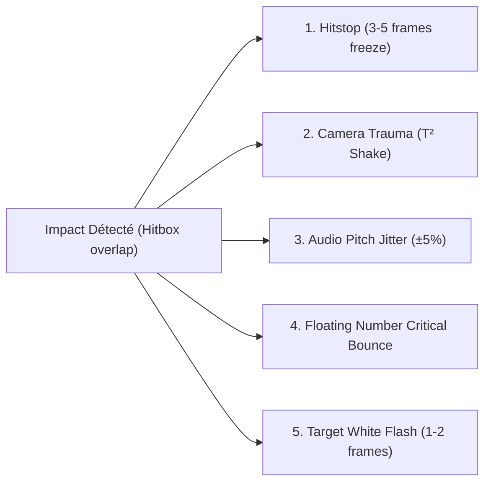

# Game Animation Polish & Combat Juice Framework

Use this skill when tuning the responsiveness, weight, and game feel of character animations, combat strikes, and locomotion transitions across any game genre (3D Action RPG, 2D Fighting, Platformer, Top-down Shooter, RTS, or MMO).

Derived from Mariel Cartwright's GDC masterclass (*Skullgirls* animation polish) and the production-tested lessons of the *Overlord* & *World of Oldcraft* autonomous marathons (solving foot sliding, turn-exit foot swaps, and floaty marshmallow attacks).

---

## 🛠️ Automated Hitstop & Curve Calculator CLI

Use `scripts/calc_hitstop_curve.py` to calculate exact millisecond timings, frame divisions, camera shake parameters, and code snippets for Unity C# and Godot:

```bash
# Calculate heavy attack hitstop curve for 60 FPS
python scripts/calc_hitstop_curve.py --weight heavy --fps 60

# Calculate light jab or snappy dagger strike
python scripts/calc_hitstop_curve.py --weight light --fps 60
```

---

## 🧒 1. Explication Pédagogique (Style 15 ans)

As-tu déjà remarqué pourquoi frapper un ennemi dans certains jeux donne une sensation incroyable de puissance (comme dans *God of War*, *Super Smash Bros* ou *Hades*), alors que dans d'autres jeux, on a l'impression de taper dans du beurre mou avec une épée en mousse ?

La différence ne vient pas des graphismes, mais du **"Game Juice"** et de la **courbe temporelle d'animation** :
1. **L'armement (Anticipation) :** Le héros recule son arme pendant 3 à 5 images pour que le joueur voie le coup venir.
2. **Le claquement (Snap) :** L'épée traverse l'écran en **une seule image (1 frame)**. C'est instantané et fulgurant.
3. **Le gel d'impact (Hitstop) :** Dès que la lame touche le monstre, l'animation **gèle pendant 4 images** (0.06s). La caméra tremble un coup sec, le son de coup est accentué, et le monstre flashe en blanc. Ce micro-gel donne au cerveau la sensation physique de résistance de la chair et du métal.
4. **La phase des pieds (Phase Matching) :** Quand un personnage s'arrête de tourner et commence à courir, au lieu de faire glisser ses pieds sur 10 cm comme sur une patinoire, le jeu cherche la pose de marche la plus proche pour que le pied droit ou gauche attaque le sol naturellement.

---

## ⏱️ 2. La Courbe d'Attaque Canonique (Skullgirls 4-Phase Timing)

Ne jamais animer un coup en interpolation linéaire continue (le piège du mouvement "mou"). Toujours rythmer l'attaque selon les 4 phases asymétriques :

```
Frame Count (at 60 FPS):
[ 1 - 4 : Anticipation ] ---> [ 5 : Snap Strike ] ---> [ 6 - 9 : Hitstop Freeze ] ---> [ 10 - 15 : Recovery ]
     (Pose d'armement)             (Contact éclair)         (Gel d'impact + Secousse)       (Amorti / Reset)
```

| Phase | Durée (Frames à 60 FPS) | Rôle & Principes Clés |
|---|---|---|
| **1. Anticipation (Wind-up)** | 3 à 6 frames | Silhouette lisible, recul du buste, arme bandée en arrière. Créer la tension visuelle. |
| **2. Active Snap (Delivery)** | 1 à 2 frames | Déplacement ultra-rapide de l'arme. Smear frame (traînée étirée) pour relier l'arc. |
| **3. Hitstop (Impact Hold)** | 3 à 5 frames (léger) / 6 à 10 frames (lourd/critique) | **Gel complet de l'animation** de l'attaquant et de la cible. Émission de particules d'impact, secousse de caméra $T^2$, et variation de pitch audio $\pm 5\%$. |
| **4. Recovery (Overshoot)** | 4 à 8 frames | L'arme dépasse la ligne d'impact (overshoot) puis revient avec amorti (cushioning) vers la pose Idle. Annulable par esquive/dash (action cancel). |

---

## 🦶 3. Locomotion Phase Matching (Éradication du Patinage de Pieds)

Le problème le plus récurrent en jeu 3D : quand un personnage termine un virage (`Turn90`) pour commencer à courir (`Run`), la transition standard mélange bêtement deux clips, ce qui intervertit le pied d'appui et fait glisser le modèle de 10 à 30 cm sur le sol.

### L'Algorithme de Phase Matching (Standard Overlord / World of Oldcraft)
Au lieu d'un fondu croisé naïf :
1. **Échantillonnage de la foulée (Bake Table) :** Pré-calculer à l'import une table de 64 poses de la boucle de course (`Run`), en enregistrant la position relative des hanches, pieds et genoux.
2. **Sélection de phase à la sortie du virage :** À la fin exacte du virage, comparer la position actuelle des jambes avec la table de 64 poses et sauter immédiatement à la phase $\phi \in [0, 1]$ la plus proche :
   $$\phi^* = \arg\min_{\phi} \sum_{j \in \{\text{feet, knees}\}} w_j \|\mathbf{p}_{\text{current}, j} - \mathbf{p}_{\text{run}(\phi), j}\|^2$$
   *(Poids : 1.0 pour les pieds, 0.25 pour les genoux).*
3. **Fondu de transition SmoothStep :** Appliquer une transition `SmoothStep` finie de **0.35 s** pour lisser le haut du corps sans modifier la foulée des jambes.
4. **Résultat chiffré :** Glissement de pieds réduit de **6.9 cm à 0.02 cm**.

```csharp
// LocomotionPhaseMatcher.cs (Unity / C# & adaptable Unreal C++)
public static float FindClosestGaitPhase(Transform[] characterBones, PoseSample[] runBakeTable)
{
    float bestScore = float.MaxValue;
    float bestPhase = 0f;

    Vector3 leftFoot = characterBones[0].localPosition;
    Vector3 rightFoot = characterBones[1].localPosition;

    for (int i = 0; i < runBakeTable.Length; i++)
    {
        float distLeft = Vector3.SqrMagnitude(leftFoot - runBakeTable[i].leftFootPos);
        float distRight = Vector3.SqrMagnitude(rightFoot - runBakeTable[i].rightFootPos);
        float totalDist = distLeft + distRight;

        if (totalDist < bestScore)
        {
            bestScore = totalDist;
            bestPhase = runBakeTable[i].phaseNormalized;
        }
    }
    return bestPhase;
}
```

---

## 💥 4. Moteur de Combat Juice Multi-Genre

Pour tout coup réussi, déclencher simultanément les 5 canaux du Juice Engine :



1. **Hitstop Temporel :** Mettre l'animateur en pause pendant 0.06s (attaque normale) ou 0.12s (coup critique / brise-garde).
2. **Camera Shake Trauma :** Calculer la secousse via une intensité polynomiale :
   $$\text{Offset} = \text{Trauma}^2 \times \text{PerlinNoise}(\text{time} \times \text{freq})$$
3. **Audio Pitch Randomization :** Varier la vitesse de lecture du son d'impact de $0.95 \times$ à $1.05 \times$ pour que 10 coups consécutifs ne sonnent jamais de façon robotique.
4. **FCT (Floating Combat Text) avec Rebond :** Chiffre de dégâts qui surgit avec échelle $\times 1.5$ puis retombe avec rebond élastique (`EaseOutBounce`).
5. **Flash Blanc Matériau :** Remplacer l'albédo de la cible par du blanc pur (`#FFFFFF`) pendant 1 ou 2 frames pour souligner l'impact rétinien.

---

## 🎮 5. Adaptation par Type de Jeu

| Genre de Jeu | Hitstop | Caméra | Locomotion | Règle d'Or |
|---|---|---|---|---|
| **Action RPG 3D (Unreal / Unity)** | 4-6 frames sur coup lourd | SpringArm avec collision de mur lisse (damping 0.15s) | Phase Matching sur Turn90 | Les pieds ne doivent jamais glisser sur le sol lors des demi-tours. |
| **2D Platformer / Metroidvania** | 3-5 frames sur ennemi | Micro-shake horizontal sur $X$ uniquement | Coyote time (100ms) + Jump Buffer (120ms) | L'attaque aérienne doit figer la chute pendant 2 frames pour donner du contrôle. |
| **Top-Down Shooter / Hack'n'Slash** | 2-3 frames (haute cadence) | Shake directionnel aligné avec le recul de tir | Rotation instantanée ou lissée à $720^\circ/\text{s}$ | Priorité absolue à la réactivité des esquives (dash cancel prioritaire sur les recovery frames). |
| **MMORPG / Tab-Target** | 0-2 frames (conserver la fluidité réseau) | Caméra orbitale troisième personne avec zoom molette | Inertialization blending (UE5) | Clarté maximale des télégraphes au sol (AOE decals) et barres de canalisation. |
