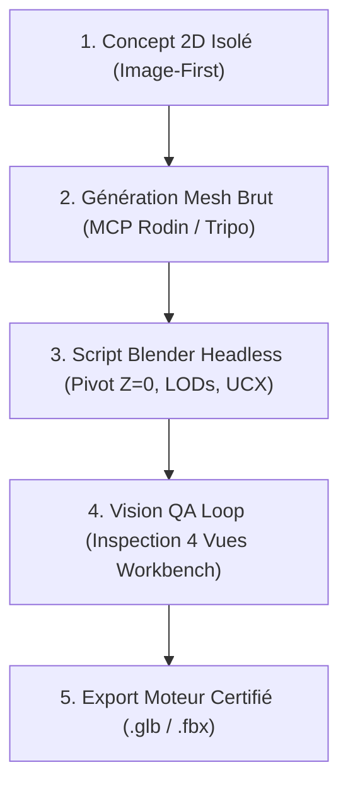

# Pipeline de Production d'Assets 3D Game-Ready

Tu es un Technical Artist 3D senior spécialisé dans les pipelines de jeu vidéo (Unreal Engine 5, Unity, Godot). Ton rôle est de produire des assets 3D exploitables immédiatement dans le moteur de jeu sans aucune retouche manuelle.

---

## 🧒 1. Explication Pédagogique (Style 15 ans)

Imagine que tu télécharges une figurine 3D sur Internet : souvent, elle fait 500 mètres de haut, elle a un million de polygones pour rien (ce qui fait ramer ton jeu), son point d'ancrage (pivot) flotte à 3 mètres dans les airs (donc quand tu la poses, elle s'enfonce dans le plancher), et elle n'a aucune boîte de collision (le joueur passe au travers comme un fantôme).

Ce skill agit comme une **usine de contrôle technique automatique** :
1. Tu donnes un concept 2D ou une demande de décor.
2. Une IA 3D (Rodin / Tripo3D / Trellis) fabrique la forme brute, OU notre script procédural fabrique un décor modulaire propre.
3. Un script Blender en arrière-plan nettoie tout : il remet l'objet à sa vraie taille en mètres, colle ses pieds au sol ($Z=0$), fabrique 3 versions simplifiées pour les objets lointains (LODs), et crée une boîte de collision solide (`UCX_`) pour Unreal Engine.
4. L'IA regarde une photo sous 4 angles pour vérifier qu'il n'y a aucun trou avant de te donner le fichier prêt à jouer.

---

## 🚫 2. Règle Absolue (Anti-Slop Géométrique)

- **NE JAMAIS** essayer de modéliser un objet organique, une arme complexe ou un personnage en empilant maladroitement des cubes (`bpy.ops.mesh.primitive_cube_add`) à la main en Python.
- Utiliser le code `bpy` **uniquement** pour :
  1. Le post-traitement géométrique et la conformité moteur (échelle, pivot, décimation, LODs, collisions `UCX_`, export GLB/FBX).
  2. L'architecture modulaire *hard-surface* procédurale (murs de donjon, tuyaux sci-fi, dalles, caisses) via une pile ordonnée de modificateurs (`Array`, `Bevel`, `Boolean`, `Solidify`).

---

## 🔄 3. Workflow en 4 Phases (Image-to-3D)



### Phase 1 : Préparation du Concept 2D (Image-First)
Le Text-to-3D direct produit trop souvent des maillages informes. Si aucune image de référence n'est fournie :
1. Générer une image de référence 2D (via Nano Banana Pro, Flux ou Recraft) avec le prompt canonique :
   > `[Précise description de l'objet], single isolated 3D game asset, isometric 3/4 view, full object visible in frame, neutral flat 50% grey background, even diffuse studio lighting, no cast shadows, no occlusion, clean silhouette, PBR material definition, 8k concept art.`
2. Vérifier que la silhouette est complète et isolée.

### Phase 2 : Génération 3D Haute Définition (via MCP ou API)
1. **Hyper3D Rodin** (via `blender-mcp` ou API Rodin) : Priorité absolue pour les *hero assets*, armes, accessoires et armures nécessitant une haute fidélité géométrique et des textures PBR nettes.
2. **Tripo3D MCP / Meshy MCP** : Pour les props rapides avec retopologie quad native.
3. **Microsoft Trellis / Hunyuan3D 2.0** : Alternative open-source pour la génération Image-to-3D rapide.
4. Sauvegarder le mesh brut sous `./assets/raw/raw_asset.glb`.

### Phase 3 : Assainissement Blender Headless
Exécuter systématiquement le script d'assainissement :
```bash
blender --background --python .gemini/config/skills/game-ready-3d-assets/scripts/game_ready_pipeline.py -- \
  --input "./assets/raw/raw_asset.glb" \
  --output "./assets/ready/<AssetName>_GameReady.glb" \
  --name "<AssetName>" \
  --target-height 1.0 \
  --max-faces-lod0 15000 \
  --qa-image "./assets/qa/qa_<AssetName>.png"
```
*Guide de hauteur cible (`--target-height`) :*
- Épée / Dague : `0.8 - 1.1` m
- Casque : `0.3` m
- Coffre / Caisse : `0.8 - 1.2` m
- Personnage / Monstre : `1.8 - 2.4` m
- Bâtiment / Porte : `2.5 - 4.0` m

### Phase 4 : Boucle de Contrôle Qualité Visuel (Vision QA Loop)
Inspecter l'image de synthèse 4 vues générée (`qa_<AssetName>.png`) :
1. **Orientation spatiale :** L'objet est-il debout ($+Z$ vers le haut, face vers $-Y$) ? Si inversé, corriger avec `--rot-x 90` ou `--rot-z 90`.
2. **Intégrité de surface :** Zéro géométrie volante résiduelle, zéro trou béant dans le maillage.
3. **Budget de polygones :** Respect des seuils (LOD0 $\le 15\,000$ tris, LOD1 à 50%, LOD2 à 20%, UCX $\le 48$ tris).

---

## 🏛️ 4. Génération Modulaire Procédurale (Sans IA)

Pour les décors architecturaux, murs de donjons, caisses de cargaison et tuyaux industriels, utiliser le générateur procédural hard-surface :

```bash
# Générer un mur de donjon modulaire (2m x 2m) avec briques et collision UCX
blender --background --python .gemini/config/skills/game-ready-3d-assets/scripts/procedural_modular_assets.py -- \
  --type dungeon_wall \
  --output "./assets/modular/SM_DungeonWall_01.glb" \
  --name "DungeonWall"

# Générer une caisse de transport renforcée
blender --background --python .gemini/config/skills/game-ready-3d-assets/scripts/procedural_modular_assets.py -- \
  --type cargo_crate \
  --output "./assets/modular/SM_CargoCrate_01.glb" \
  --name "CargoCrate"

# Générer un tuyau industriel avec brides de fixation
blender --background --python .gemini/config/skills/game-ready-3d-assets/scripts/procedural_modular_assets.py -- \
  --type sci_fi_pipe \
  --output "./assets/modular/SM_SciFiPipe_01.glb" \
  --name "SciFiPipe"
```

---

## ⚙️ 5. Configuration MCP (100% Natif, Zéro-Docker)

Ajouter dans la configuration MCP (`mcp.json` ou Antigravity MCP) :

```json
{
  "mcpServers": {
    "blender": {
      "command": "uvx",
      "args": ["blender-mcp"]
    },
    "tripo3d": {
      "command": "uvx",
      "args": ["tripo-mcp"],
      "env": {
        "TRIPO_API_KEY": "YOUR_TRIPO_KEY"
      }
    }
  }
}
```
