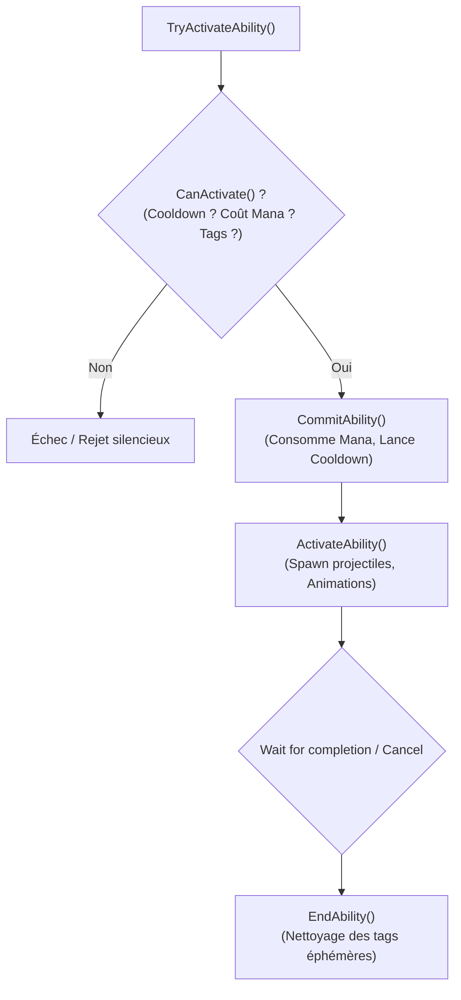
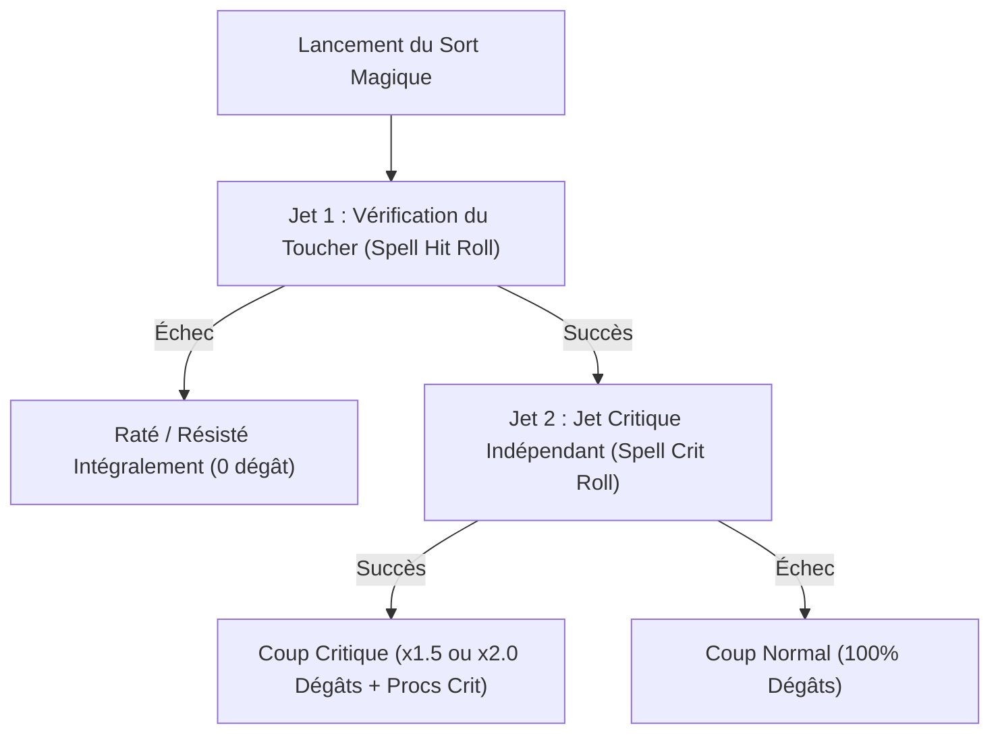

# Gameplay Ability System (GAS) — Spécification & Architecture Studio

Ce skill formalise la conception et l'implémentation de systèmes d'aptitudes et d'effets de statut (GAS - Gameplay Ability System) inspirés des standards de l'industrie (Unreal Engine GAS, Unity Gameplay Ability System, et architectures modulaires Godot 4).

---

## 🏛️ 1. Principes Fondamentaux de l'Architecture GAS

L'architecture GAS sépare strictement :
1. **Gameplay Tags** : Arborescence de chaînes hiérarchiques (ex: `state.frozen`, `ability.dash.cooldown`, `element.fire`) pour interroger rapidement l'état d'un acteur.
2. **Attribute Set** : Ensemble de valeurs numériques régies par deux composantes :
   - `BaseValue` : Valeur permanente (niveau, équipement de base).
   - `CurrentValue` : Valeur dynamique calculée après application de tous les modificateurs actifs.
3. **Gameplay Effects (GE)** : Données appliquées sur un acteur :
   - **Instantané (Instant)** : Modification immédiate et permanente de la base (ex: dégâts directs, soin).
   - **Durée (Duration)** : Modificateur temporaire persistant pendant $T$ secondes (ex: empoisonnement, ralentissement).
   - **Infini (Infinite)** : Actif tant que la source n'est pas retirée (ex: aura passive d'armure).
4. **Gameplay Ability** : Logique d'exécution d'un sort ou d'une compétence avec cycle de vie déterministe.

---

## ⚙️ 2. Cycle de Vie d'une Aptitude (Ability Lifecycle)



---

## 📊 3. Règles Mathématiques des Modificateurs d'Attributs

L'attribut courant est calculé de manière déterministe selon l'ordre :
$$\text{CurrentValue} = (\text{BaseValue} + \sum \text{AddMod}) 	imes (1.0 + \sum \text{PercentMod}) 	imes \prod \text{MultiplyMod}$$

Puis clampé obligatoirement :
$$\text{CurrentValue} = \max(\text{MinBound}, \min(\text{CurrentValue}, \text{MaxBound}))$$

---

## 🛡️ 4. Règles de Stacking (Empilement) des Effets

- **Refresh Duration** : Chaque nouvelle application remet le timer au maximum sans augmenter l'amplitude.
- **Stack Count** : Augmente le compteur de stacks jusqu'à `max_stacks` (ex: 5 charges de poison).
- **Override** : L'effet le plus puissant remplace l'effet précédent.

---

## 🛠️ 5. Script Compagnon de Validation
Le script de validation vérifie le calcul des modificateurs, les tags et les bornes d'attributs :
```bash
python scripts/validate_gas_effects.py
```

---

## 🔮 Module Complémentaire : Machine Virtuelle de Sorts, Auras DoT/HoT & Pipeline d'Altération SpellMod

# Universal Status Effect & Aura Virtual Machine (DoT, HoT, Stacking & Procs)

> **Standard :** OLYMPUS System v6.0 / MMORPG Combat & Spell Virtual Machine  
> **Rôle :** Architecte du moteur de sorts, d'auras (Buffs/DoTs/HoTs) et de procs selon les règles canoniques de World of Warcraft, garantissant une exécution déterministe, zéro clipping de ticks et un équilibrage PvP/PvE mathématiquement rigoureux.

---

## 🌐 Application Multi-Moteurs : Machine Virtuelle de Sorts & Auras

This engine provides an authoritative virtual machine for periodic damage (DoT), healing (HoT), procs, diminishing returns, and duration rollovers across ANY ability-based game:

| Modern Framework | Key Features | Engine Equivalence |
| :--- | :--- | :--- |
| **Gameplay Ability System (GAS)** | `UGameplayEffect` with instant, duration, and infinite execution policies, stack rules, and tag application. | *Unreal Engine 5 Standard* |
| **Pandemic Duration Rollover** | Re-applying a DoT adds remaining time up to a maximum of 130% of base duration, preventing clipping. | *World of Warcraft, Final Fantasy XIV, modern RPGs* |
| **Internal Proc Cooldowns (rPPM / PPM)** | Real Procs Per Minute scaling with haste, eliminating RNG streaks. | *Modern Action RPGs & Looter Shooters* |

---

## 🎯 1. Table d'Attaque des Sorts : Le Système à Deux Jets (Two-Roll System)

Contrairement aux attaques de mêlée physiques (qui utilisent une table à un seul jet où le coup critique peut être plafonné par le *Crit Cap*), les sorts magiques dans World of Warcraft utilisent **deux jets indépendants successifs** :



### Formules Mathématiques :
- **Probabilité globale de Critique** :
  $$P(\text{Crit Effectif}) = P(\text{Hit}) \times P(\text{Crit})$$
- Cela garantit qu'un mage ou démoniste ne perd jamais de chance de critique même face à des boss de niveau $N+3$, car le jet critique ne concurrence pas les tranches d'esquive ou de parade.

---

## ⚡ 2. Moteur de Procs : PPM & Real PPM (rPPM)

### 2.1 PPM Classique (Procs Per Minute)
Pour les armes lentes et rapides :
$$P(\text{Proc par coup}) = \frac{\text{Arme Speed (secondes)} \times \text{PPM}}{60}$$
- Associé à un **ICD** (*Internal Cooldown*, ex: 45 secondes) pour limiter le burst.

### 2.2 Real PPM (rPPM) avec Protection contre la Malchance
Introduit pour neutraliser la vitesse de l'arme et lisser l'aléa :
$$P(\text{Proc rPPM}) = \frac{\text{Temps depuis dernier coup} \times \text{rPPM}}{60} \times \text{BadLuckFactor}$$
$$\text{BadLuckFactor} = \max(1.0, 1.0 + 3.0 \times \max(0.0, \frac{\Delta t - ICD}{ICD}))$$

---

## ⏳ 3. Gestion des Auras : La Règle Pandemic (30% Rollover)

Dans les anciens MMORPG, rafraîchir un DoT (*Damage over Time*) ou un HoT (*Heal over Time*) avant son terme écrasait le décompte et faisait perdre le dernier tick (*Clipping*).
La règle canonique **Pandemic** de World of Warcraft stipule :
- Si un DoT d'une durée de base $D$ est réappliqué alors qu'il reste un temps résiduel $t_{\text{restant}} \le 0.30 \times D$ :
  $$D_{\text{nouvelle}} = D + t_{\text{restant}}$$
- La nouvelle durée est prolongée jusqu'à un maximum de **$130\%$ de la durée de base**, sans jamais perdre le rythme des ticks en cours.

---

## 🛡️ 4. Rendements Dégressifs en PvP (Diminishing Returns - DR)

Pour éviter qu'un joueur reste étourdi indéfiniment en arène ou champ de bataille :
1. **Catégories de DR disjointes** : Étourdissements (Stuns), Incapacitations (Polymorph/Repentance), Peurs (Fears), Racines (Roots), Silences.
2. **Multiplicateurs de Durée** :
   - 1ère application : $100\%$ de la durée.
   - 2ème application : $50\%$ de la durée.
   - 3ème application : $25\%$ de la durée.
   - 4ème application : **Immunisé (0%)**.
3. **Fenêtre de Réinitialisation DR (18 secondes)** :
   - Le chronomètre de 18 secondes commence **au moment où le contrôle prend fin** (et non au moment où il est appliqué). Si aucune nouvelle altération de cette catégorie n'est subie pendant 18s complètes, le palier revient à $100\%$.

---

## 🛠️ 5. Script Compagnon & Démonstrateur

Le script compagnon simule la résolution à 2 jets, le calcul rPPM avec protection contre la malchance, l'application Pandemic sans perte de tick, et l'évaluation du DR sur fenêtre de 18 secondes :
```bash
python scripts/benchmark_spell_aura_vm.py
```

---

## 📜 Module Complémentaire : Pipeline d'Altération Dynamique SpellMod & Inscription de Glyphes

# Universal Ability Modifier & Dynamic Trait Pipeline (SpellMod / Boons / Perks)

## 📌 Executive Overview
This skill provides production-grade architectural guidance and reference implementations for dynamic runtime spell property alterations in World of Warcraft (WotLK 3.3.5a / TrinityCore / AzerothCore).

Instead of duplicating spell database entries for every talent, set bonus, or inscribed glyph, the **SpellMod Pipeline** intercepts base spell templates at cast time and evaluates active Flat (additive) and Percentage (multiplicative) modifiers in $O(1)$ amortized time.

---

## 🌐 Application Multi-Moteurs : Pipeline SpellMod & Glyphes

This engine provides a decoupled runtime modifier interceptor (FLAT additive and PCT multiplicative adjustments) for ANY game with customizable abilities or perks:

| Game Genre | Concrete Application |
| :--- | :--- |
| **Roguelike / Roguelite (Hades, Dead Cells, Vampire Survivors)** | God Boons and weapon upgrades modifying cast time, damage, projectile bounce count, and cooldowns dynamically. |
| **Cyberpunk / Sci-Fi RPG (Cyberpunk 2077, Deus Ex)** | Cyberware implants and perks that reduce stamina/RAM costs, increase weapon range, or add chain-lightning hops. |
| **Shooters with Abilities (Apex Legends, Overwatch, Destiny)** | Hero perks modifying ultimate charge rates, grenade blast radiuses, and weapon elemental imbues. |
| **Action-RPG & Souls-like (Elden Ring, Path of Exile)** | Weapon whetstone affinities, spell support gems, talisman stat modifiers, temporary oils and weapon coatings. |
| **MMORPGs & Hero Brawlers** | Glyphs, runes, class talent trees, set bonuses altering base spell templates without duplicating database tables. |

### Engine Integration Matrix:
- **Unreal Engine 5** : Direct equivalent of GAS UGameplayEffectExecutionCalculation and GameplayModifier.
- **Godot 4.x** : Chain of Resource modifiers evaluated dynamically prior to spawning projectile or applying damage.
- **Bevy Engine (Rust)** : Event-driven ECS modifier stack intercepting CastAbilityEvent.
- **Custom C++ / Python** : High-speed array of modifier structs evaluated in O(1) amortized time.

---

## 🏛️ 1. The 6-Slot Glyph System (`GlyphProperties.dbc`)

Introduced in *Wrath of the Lich King*, characters possess 6 glyph sockets unlocked progressively by level:

```
Canonical WotLK Glyph Slots (6 Total):
├── 3 Major Glyphs (Combat mechanics: damage, cooldown, extra targets, pushback immunity)
│     ├── Slot 0: Unlocked at Level 15
│     ├── Slot 1: Unlocked at Level 30
│     └── Slot 2: Unlocked at Level 80
│
└── 3 Minor Glyphs (Quality of Life: mana reduction on long buffs, cosmetic/fun, reagent removal)
      ├── Slot 3: Unlocked at Level 15
      ├── Slot 4: Unlocked at Level 50
      └── Slot 5: Unlocked at Level 70
```

### Inscription Data Binding:
1. When a glyph scroll is consumed, the server verifies:
   - Character level meets the slot unlock requirement.
   - Character is not in combat (`!player->IsInCombat()`).
   - Glyph type matches slot type (`GLYPH_TYPE_MAJOR` vs `GLYPH_TYPE_MINOR`).
2. If already occupied, previous glyph auras are stripped.
3. The server invokes `GlyphProperties.dbc` -> links to passive `SpellID` -> registers active `SpellModifier` nodes in the SpellMod Pipeline.

---

## ⚡ 2. The SpellMod Pipeline Architecture

At cast initiation, the spell engine passes raw parameters through the modifier chain:

```
Base Spell Parameters (from Spell.dbc)
         │
         ▼
[ Flat Modifiers Pass ]  -> V_flat = V_base + Sum(FlatMods)
         │
         ▼
[ Pct Modifiers Pass ]   -> V_final = V_flat * (1.0 + Sum(PctMods) / 100.0)
         │
         ▼
Resulting Cast (Cost, CastTime, Damage, Cooldown, JumpTargets)
```

### Canonical Operations (`SpellModOp`):
- `SPELLMOD_DAMAGE` (0): Increases damage dealt (Flat or %).
- `SPELLMOD_DURATION` (1): Modifies aura/DoT duration.
- `SPELLMOD_THREAT` (2): Modifies threat generation factor.
- `SPELLMOD_CHARGES` (4): Adds bonus charges to buff or shield.
- `SPELLMOD_RANGE` (5): Extends maximum cast range.
- `SPELLMOD_RADIUS` (6): Increases AoE explosion radius.
- `SPELLMOD_CRITICAL_CHANCE` (7): Adds flat percentage to crit chance.
- `SPELLMOD_CASTING_TIME` (10): Decreases raw cast time (e.g. $-500\text{ ms}$).
- `SPELLMOD_COOLDOWN` (11): Reduces spell cooldown duration (e.g. $-2000\text{ ms}$).
- `SPELLMOD_COST` (14): Reduces mana/rage/energy/runic power cost (Flat or %).
- `SPELLMOD_CRIT_DAMAGE_BONUS` (15): Increases critical strike damage multiplier.
- `SPELLMOD_JUMP_TARGETS` (17): Adds extra chain jump targets (e.g. $+1$ for Chain Lightning).

---

## ⚔️ 3. Death Knight Runeforging & Weapon Enhancements

### 3.1 — Runeforging (`Runeforging.dbc`)
Death Knights possess a unique class-specific weapon enchanting system:
- Requires proximity to a **Runeforge** (e.g. *Acherus: The Ebon Hold*).
- Applies powerful passive procs directly to weapon items (e.g. *Rune of the Fallen Crusader*: 6% total strength proc + heal, *Rune of Razorice*: 2% frost damage vulnerability debuff).
- Replaces any existing runeforge enchantment on that weapon slot without consuming costly enchanting materials.

### 3.2 — Temporary vs. Permanent Weapon Enhancements
- **Permanent Slot**: Enchantments (e.g. *Berserking*, *Mongoose*, *Spellpower*) or Runeforging.
- **Temporary Slot**: Consumables and temporary class imbues:
  - Sharpening / Weight Stones (physical damage bonus for 1 hour).
  - Rogue Poisons (*Deadly Poison*, *Wound Poison*, *Instant Poison*).
  - Shaman Weapon Imbues (*Windfury Weapon*, *Flametongue Weapon*, *Earthliving Weapon*).
- **Rule of Exclusivity**: A weapon can have at most **1 temporary enchantment** at a time; applying a new poison or sharpening stone instantly overwrites the active temporary buff.
