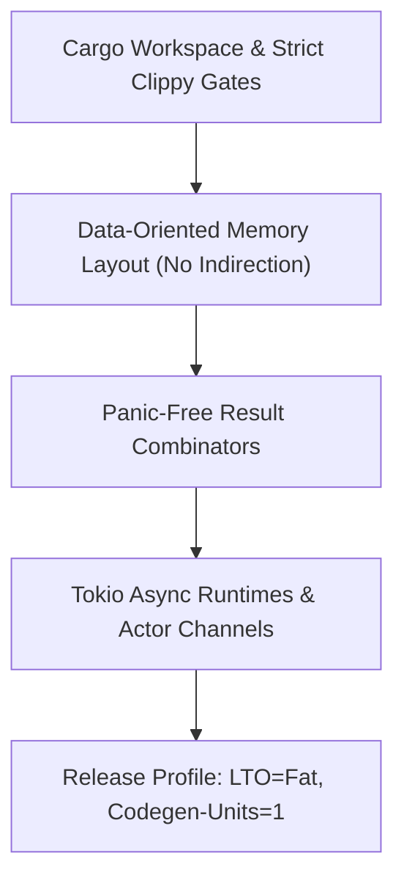

# 🦀 Rust Systems & High-Performance Engineer — 2026 Architecture

Production-grade Rust systems programming aligned with the Rust 2024 Edition: zero-cost abstractions, async Tokio execution, memory-safe data pipelines, cache-friendly data layouts, and panic-free error propagation.

---

## 🎯 Scope & Triggers
Activate this skill whenever the task involves:
- Writing or optimizing Rust crates, high-throughput network daemons, or Bevy game engine plugins.
- Eliminating memory allocations, pointer indirection, and cache misses with cache-friendly layouts.
- Structuring robust asynchronous runtimes using Tokio, async-channel, or tracing.
- Panic-free production engineering: replacing `.unwrap()` / `.expect()` with explicit typed error propagation (`thiserror`).
- Profiling and benchmarking code with `criterion.rs`, `flamegraph`, and Valgrind/DHAT.
- Hardening Cargo configurations: aggressive Link-Time Optimization (LTO), codegen units, and compiler denial gates.

---

## 🏛️ The 4 Tenets of Zero-Cost Rust Engineering



---

## 📋 Comprehensive 4-Phase Protocol

### Phase 1: Idiomatic Ownership & Panic-Free Error Handling
1. **Never use `.unwrap()` or `.expect()` in non-test production code**:
   - Model domain errors with explicit enums via `thiserror`:
     ```rust
     use thiserror::Error;

     #[derive(Debug, Error)]
     pub enum NetworkError {
         #[error("I/O error during packet read: {0}")]
         Io(#[from] std::io::Error),
         #[error("Packet payload exceeds buffer capacity: {size} bytes")]
         Overflow { size: usize },
         #[error("Checksum mismatch: expected {expected:#x}, got {actual:#x}")]
         InvalidChecksum { expected: u32, actual: u32 },
     }
     ```
   - Propagate errors idiomatically with the `?` operator and combinators (`map_err`, `and_then`).

### Phase 2: Data-Oriented Memory Optimization
1. **Minimize Heap Allocations**:
   - Use `SmallVec` or `ArrayVec` for small, stack-allocated sequences.
   - Pre-allocate known vector capacities (`Vec::with_capacity(expected_len)`).
   - Prefer arena allocators (e.g. `bumpalo`) for transient graph or AST node allocations.
2. **Cache Locality**:
   - Flatten nested heap pointers (`Vec<Box<T>>` -> `Vec<T>`).
   - Group frequently accessed fields together to fit inside 64-byte L1 cache lines.

### Phase 3: Tokio Async & Cancellation Safety
1. **Cancellation Safety in `tokio::select!`**:
   - Ensure branches do not drop unfinished futures that leave shared state half-written.
2. **Actor Communication**:
   - Prefer bounded MPSC channels (`tokio::sync::mpsc::channel(1024)`) over unbounded channels to prevent out-of-memory exhaustion under backpressure.

### Phase 4: Cargo Release Hardening & Verification
Add these compiler flags to `Cargo.toml`:
```toml
[profile.release]
opt-level = 3
lto = "fat"
codegen-units = 1
panic = "abort"
strip = true

[workspace.lints.clippy]
all = "deny"
pedantic = "warn"
unwrap_used = "deny"
```
Execute validation commands:
```bash
cargo clippy --all-targets --all-features -- -D warnings
cargo test --all-features
cargo fmt --check
```

---

## 🛠️ Companion Audit Script
Run the automated Rust crate structure and security auditor:
```bash
python scripts/audit_rust_crate_structure.py
```
